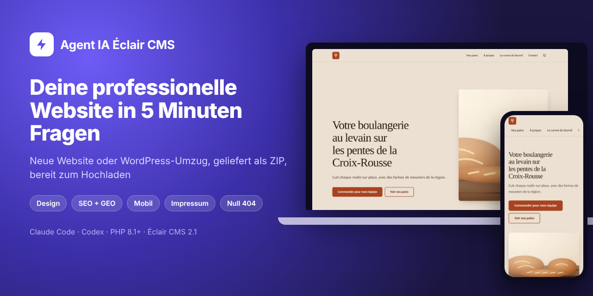
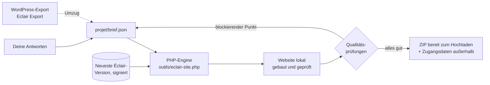

<p align="center">
  <a href="README.md">Français</a> · <a href="README.en.md">English</a> · <a href="README.es.md">Español</a> · <a href="README.it.md">Italiano</a> · <b>Deutsch</b> · <a href="README.pt.md">Português</a>
</p>

<p align="center">
  
</p>

<p align="center">
  <a href="MISES-A-JOUR.md"></a>
  <a href="https://github.com/Jacckisback/eclair-cms"></a>
  
  
  
</p>

# Agent IA Éclair CMS

**Ein Agent für Claude Code oder Codex, der deine professionelle Website von A bis Z erstellt – oder deine WordPress-Website zu Éclair CMS umzieht, ohne eine einzige Adresse zu verlieren.**

Du beantwortest etwa 5 Minuten lang Fragen. Der Agent baut die komplette Website auf deinem Computer mit der neuesten Version von [Éclair CMS](https://github.com/Jacckisback/eclair-cms): Seiten, Texte, Art Direction, Bilder, SEO, GEO (KI-Antwortmaschinen), mobile Version, rechtliche Seiten und Admin-Konto. Er prüft jede Seite und liefert dir dann **eine ZIP-Datei, bereit zum Hochladen auf dein Hosting**, mit einer Schritt-für-Schritt-Installationsanleitung.

Du musst kein Entwickler sein: Der Agent stellt die Fragen, übernimmt die Technik und erklärt dir jeden Klick.

> Der Agent spricht in der Sprache des Nutzers. Seine Anweisungen und die Beispielseiten sind auf Französisch; die Rechtsvorlagen decken Frankreich und Spanien im Detail ab, andere Länder anhand offizieller Quellen (für Deutschland z. B. Impressum und DSGVO, vom Agenten aus offiziellen Quellen geprüft und als „zu prüfen“ markiert).

---

## Inhalt

- [Was du bekommst](#was-du-bekommst)
- [Vorschau](#vorschau)
- [Schnellstart](#schnellstart)
- [Weg 1: eine neue Website erstellen](#weg-1-eine-neue-website-erstellen)
- [Weg 2: eine WordPress-Website umziehen](#weg-2-eine-wordpress-website-umziehen)
- [So funktioniert es](#so-funktioniert-es)
- [Automatische Qualitätsprüfungen](#automatische-qualitätsprüfungen)
- [Sicherheit und Vertrauen](#sicherheit-und-vertrauen)
- [Voraussetzungen](#voraussetzungen)
- [Befehle der Engine](#befehle-der-engine)
- [Aufbau des Repositorys](#aufbau-des-repositorys)
- [Häufige Fragen](#häufige-fragen)
- [Bekannte Grenzen](#bekannte-grenzen)
- [Éclair-Ökosystem](#éclair-ökosystem)

---

## Was du bekommst

| | |
|---|---|
| 🧭 **Ein geführter Ablauf** | Eine Frage nach der anderen, mit anklickbaren Antworten und immer der Option „Berate mich“. |
| 🎨 **Echtes Design** | 3 Art Directions passend zu deinem Geschäft (12 sind in Éclair enthalten, oder eine eigene), WCAG-Kontraste garantiert. |
| ✍️ **Texte ohne Erfundenes** | Ein Geschäftsprofil sammelt deine echten Leistungen, Öffnungszeiten, Preise und Nachweise. Keine erfundenen Zahlen, Bewertungen oder Siegel. |
| 🖼️ **Bilder** | Deine Fotos oder KI-Bilder mit deinem eigenen Schlüssel (empfohlen: fal.ai; auch OpenAI oder Black Forest Labs). |
| 🔎 **SEO und GEO** | Fokus-Keyword, Titel, Meta-Beschreibungen, „Das Wichtigste“-Zusammenfassungen, FAQ, strukturierte Daten, `sitemap.xml`, `robots.txt`, `llms.txt`. Ziel: 80/100 und mehr. |
| 📱 **Mobile first** | Das Éclair-Theme ist für Lighthouse 100 gebaut; Menüs und Titel werden für kleine Bildschirme geprüft. |
| ⚖️ **Rechtliche Seiten** | Frankreich (LCEN, Verbraucherschlichtung), Spanien (LSSI, LOPDGDD), DSGVO, reglementierte Berufe, AGB für einen Shop; andere Länder aus offiziellen Quellen. |
| 🔁 **WordPress-Umzug** | Mit dem Plugin [Eclair Export](https://github.com/Jacckisback/eclair-export): Inhalte, Bilder, PDFs, SEO, Menüs, Weiterleitungen, **null 404**. |
| 📦 **Ein ZIP, bereit zum Hochladen** | Der Website-Ordner, die Installationsanleitung, die Qualitätsberichte. Das Passwort wird **neben** dem ZIP geliefert, nie darin. |

## Vorschau

Beispiel, das mit dem Agenten geliefert wird: *Le Fournil des Pentes*, eine fiktive Bäckerei, vom Agenten gebaut (Art Direction „Argile“).

<table>
  <tr>
    <td width="72%"></td>
    <td width="28%"></td>
  </tr>
  <tr>
    <td align="center"><sub>Startseite auf dem Computer</sub></td>
    <td align="center"><sub>Startseite auf dem Smartphone</sub></td>
  </tr>
</table>

<p align="center"><br><sub>Eine Unterseite: Liste, Bild, FAQ, ausgezeichnet für Google und KI-Systeme</sub></p>

<p align="center"><br><sub>Die Verwaltung der gelieferten Website: Inhalte, SEO- und GEO-Werte, Prioritäten</sub></p>

<p align="center"><br><sub>Die Engine: neueste Éclair-Version geprüft, Installation, Inhalte, Qualitätsprüfung, ZIP</sub></p>

## Schnellstart

**1. Lade den Agenten herunter**

- Am einfachsten: [`Agent-IA-Eclair-CMS-v1.1.0.zip`](https://github.com/Jacckisback/agent-ia-eclair-cms/raw/main/dist/Agent-IA-Eclair-CMS-v1.1.0.zip) (SHA-256 in [`dist/SHA256SUMS.txt`](dist/SHA256SUMS.txt)), an beliebiger Stelle entpacken.
- Oder mit git:

```bash
git clone https://github.com/Jacckisback/agent-ia-eclair-cms.git
cd agent-ia-eclair-cms
```

**2. Öffne den Ordner in Claude Code** („Open folder“ oder `claude` im Ordner). Mit Codex genauso.

**3. Füge diese Nachricht ein:**

```text
Hallo! Lies CLAUDE.md und dann REGLES.md und starte die Erstellung meiner Website mit Éclair CMS. Stell mir die Fragen nacheinander, auf Deutsch.
```

Die erste Frage lautet: **neue Website** oder **WordPress-Umzug**? Am Ende liegt alles in `sortie/`.

## Weg 1: eine neue Website erstellen

| Schritt | Was der Agent macht |
|---|---|
| 1. Dein Geschäft | Eine einzige offene Frage: was du machst, für wen, wo. |
| 2. Geschäftsprofil | Deine Leistungen, dein Gebiet, Öffnungszeiten, Preise oder Angebote, was dich auszeichnet, echte Nachweise. |
| 3. Der Vorschlag | Website-Typ, Seiten, Menü, Tonalität und 3 Art Directions, mit einem Klick bestätigt. |
| 4. Die Adresse der Website | Domain schon gekauft, noch zu kaufen (er schlägt Namen vor) oder später. Hosting-Prüfung. |
| 5. Die Bilder | Deine Fotos, KI-Bilder (er erklärt, wie du den Schlüssel bekommst) oder keine Bilder. |
| 6. Die rechtlichen Seiten | Ein kurzes Formular, angepasst an dein Land und deine Rechtsform. |
| 7. Das Admin-Konto | Name, E-Mail, kurze Bio (Autorenseite). Sicheres Passwort wird erzeugt. |
| 8. Der Bau | Texte, Bilder, komplette Website, Auswertung der SEO/GEO-Werte und Verbesserung der Texte. |
| 9. Die Lieferung | Das ZIP, eine Installationsanleitung in 5 Schritten und die nächsten 3 Prioritäten. |

## Weg 2: eine WordPress-Website umziehen

Der Agent führt dich Schritt für Schritt mit dem kostenlosen Plugin **[Eclair Export](https://github.com/Jacckisback/eclair-export)**. Der Agent verändert dein WordPress nie; es bleibt bis zur Umstellung online.

1. **Eclair Export installieren** auf deinem WordPress: Der Agent gibt dir die Datei und jeden Klick (Plugins › Installieren › Plugin hochladen).
2. **Diagnose**: Der Agent liest den Bericht und sagt dir, was unverändert übernommen wird, was vereinfacht wird (Elementor, Divi) und was in Éclair neu gebaut wird (Formulare, Widgets, Shop).
3. **Geschwindigkeit der alten Website** wird vor der Umstellung notiert, für den Vorher-nachher-Bericht.
4. **Export**: Du legst die Dateien in `projet/migration/` ab.
5. **Simulation**: vollständige Bilanz, ohne etwas zu schreiben, mit einer Lösung für jedes Element, das nicht umzieht.
6. **Umzug** mit dem offiziellen Importer von Éclair, danach neues Design, rechtliche Seiten geprüft, Formulare durch das Éclair-Formular ersetzt, Warenkorbseiten depubliziert und weitergeleitet.
7. **Prüfung jeder alten Adresse**: Seiten, Kategorien, Schlagwörter, Autoren, `?p=`-Links, Feeds, Dateien unter `/wp-content/uploads/…` (Bilder, Vorschaubilder, PDFs). Alle müssen auf die richtige Seite führen.
8. **Umstellung**: Anleitung für dasselbe Hosting (mit Rückweg) oder ein neues Hosting (DNS, E-Mail, HTTPS), danach Migrationsbericht für deinen Kunden und Kontrolle in der Search Console.

<p align="center"><br><sub>Umzug des mitgelieferten Beispiels: 12 von 12 alten Adressen führen zur richtigen Seite</sub></p>

<table>
  <tr>
    <td width="68%"></td>
    <td width="32%"></td>
  </tr>
  <tr>
    <td align="center"><sub>Die umgezogene Website mit ihrer neuen Art Direction</sub></td>
    <td align="center"><sub>Ein umgezogener Beitrag: Contact Form 7 durch das Éclair-Formular ersetzt</sub></td>
  </tr>
</table>

## So funktioniert es



- Der Agent schreibt alles, was er erfährt, in `projet/brief.json`.
- Die Engine lädt **die neueste Éclair-Version** herunter, prüft ihre **Ed25519-Signatur** und den SHA-256-Hash und installiert sie mit dem offiziellen Éclair-Installer auf einem lokalen PHP-Server.
- Sie wendet den Brief an (Einstellungen, Inhalte, Bilder, Menüs, Design) oder importiert das WordPress-Paket mit dem offiziellen Importer von Éclair.
- Sie prüft das Ergebnis Seite für Seite. Ein blockierender Punkt bedeutet: kein ZIP. Der Agent korrigiert den Brief und startet neu.

Inhalt des gelieferten ZIP:

```text
sortie/
├── meine-website-eclair-v2.1.0.zip
│   └── meine-website/
│       ├── site/                   ← in den öffentlichen Ordner des Hostings hochladen
│       ├── INSTALLATION.md         ← die Anleitung, an diese Website angepasst
│       ├── RAPPORT-QUALITE.json    ← Prüfung jeder Seite
│       └── ANALYSE-SEO-GEO.json    ← Werte und Verbesserungshinweise
└── meine-website-ACCES-ADMIN.txt   ← Admin-Adresse und Passwort (nie online)
```

## Automatische Qualitätsprüfungen

Auf jeder Seite: Status 200, mobiles `viewport`-Tag, genau eine H1-Überschrift, Meta-Beschreibung, strukturierte Daten (JSON-LD), Alternativtexte der Bilder, Titellänge. Auf der Website: `sitemap.xml`, `robots.txt`, `llms.txt`.

**Die Lieferung wird blockiert** (kein ZIP), wenn:

- ein Platzhalter „[À compléter]“ (noch auszufüllen) sichtbar bliebe;
- ein WordPress-Shortcode (`[contact-form-7 …]`) weiterhin angezeigt würde;
- eine alte WordPress-Adresse auf einem 404 enden oder zur Startseite statt zur passenden Seite führen würde;
- eine zu ersetzende Rechtsseite nicht gefunden wird, die Fußzeile leer ist oder ein Menüeintrag fehlt;
- eine Weiterleitung durch eine noch veröffentlichte Seite verdeckt würde.

## Sicherheit und Vertrauen

- **Alles passiert auf deinem Computer.** Der Agent lädt nichts auf dein Hosting hoch, kauft nichts und installiert keine Software ohne deine Zustimmung.
- **Geprüftes Éclair**: Ed25519-Signatur des Maintainers und SHA-256-Hash, genau wie Éclair es für seine eigenen Updates macht.
- **Geprüfte Éclair-Skills** mit einem im Agenten eingebauten öffentlichen Schlüssel (`outils/verifier-skills.php`), nie mit einem Skript aus dem heruntergeladenen Repository.
- **API-Schlüssel** nur in `projet/.env`, nie im Brief oder in der Website.
- **Passwort** sicher erzeugt und außerhalb des ZIP geliefert; individuelle Admin-Adresse (nie `/admin`).
- **Nichts Erfundenes**: keine Preise, Bewertungen, Siegel oder Berufsjahre ohne Quelle.
- **Umzug**: Dein WordPress wird nicht angefasst; vor der Umstellung wird ein vollständiges Backup verlangt; die alte Website wird mindestens 3 Monate aufbewahrt.

## Voraussetzungen

- **Claude Code** (Desktop-App oder Terminal) oder **Codex**.
- **PHP 8.1 oder neuer** auf deinem Computer, mit `curl`, `zip`, `mbstring`, `dom`, `zlib` (idealerweise `gd`, `sodium`). Der Agent prüft das und bietet die Installation an, falls etwas fehlt.
- **git** (um den Skill Éclair Design und den Skill-Katalog zu laden).
- Ein **Webhosting** mit PHP 8.1+ und Apache oder LiteSpeed (fast alle Shared-Hosting-Angebote).
- Optional: ein Konto bei **fal.ai**, OpenAI oder Black Forest Labs für KI-Bilder.
- Für einen Umzug: Admin-Zugang zum WordPress (WordPress 6.0+, PHP 7.4+).

## Befehle der Engine

Der Agent führt sie für dich aus. Du kannst sie auch direkt verwenden:

| Befehl | Zweck |
|---|---|
| `php outils/eclair-site.php version` | Neueste veröffentlichte Éclair-Version (signierte Ankündigung) |
| `php outils/eclair-site.php construire projet/brief.json` | Baut eine neue Website und liefert das ZIP |
| `php outils/eclair-site.php simuler projet/brief.json` | Umzug: Simulation des Imports, nichts wird geliefert |
| `php outils/eclair-site.php migrer projet/brief.json` | Umzug: Import, Einstellungen, Prüfung der alten Adressen, ZIP |
| `php outils/eclair-site.php verifier sortie/<website>/site` | Qualitätsprüfung einer bereits gebauten Website |
| `php outils/images.php projet/brief.json` | Erzeugt fehlende Bilder (fal.ai, OpenAI, FLUX) |
| `php outils/verifier-skills.php <ordner>` | Prüft heruntergeladene Éclair-Skills |

Probiere die mitgelieferten Beispiele:

```bash
php outils/eclair-site.php construire exemples/fournil-des-pentes/brief.json
php outils/eclair-site.php migrer exemples/migration-wordpress/brief.json
```

## Aufbau des Repositorys

| Datei oder Ordner | Zweck |
|---|---|
| `COMMENCER-ICI.md` | Einstiegsanleitung (Französisch) |
| `CLAUDE.md`, `AGENTS.md`, `REGLES.md` | Anweisungen des Agenten für Claude Code und Codex |
| `.claude/skills/`, `.agents/skills/` | Vollständige Methode: Ablauf, Design, Bilder, SEO/GEO, Rechtliches, Umzug, Lieferung |
| `outils/` | Engine für Bau, Umzug und Prüfung (PHP, ohne Abhängigkeiten) |
| `projet/` | Dein Brief, Fortschritt, Bilder und WordPress-Exporte |
| `exemples/fournil-des-pentes/` | Beispiel für eine neue Website (fiktive Bäckerei) |
| `exemples/migration-wordpress/` | Umzugsbeispiel mit einem Demo-Paket von Eclair Export |
| `DEPANNAGE.md` | Fehlerbehebung |
| `MISES-A-JOUR.md` | Änderungen jeder Version |
| `dist/` | Herunterladbares ZIP und sein Hash |

## Häufige Fragen

<details>
<summary><b>Muss ich programmieren können?</b></summary>

Nein. Der Agent stellt die Fragen in einfacher Sprache, übernimmt die Technik und erklärt dir jeden Schritt bis zur Veröffentlichung. Du musst nur einen Ordner in Claude Code oder Codex öffnen.
</details>

<details>
<summary><b>Wie lange dauert es?</b></summary>

Etwa 5 Minuten Fragen für eine neue Website, beim allerersten Mal plus 5 bis 15 Minuten, falls PHP installiert werden muss. Ein WordPress-Umzug braucht zusätzlich die Zeit für den Export (2 bis 15 Minuten je nach Website).
</details>

<details>
<summary><b>Was kostet das?</b></summary>

Der Agent und Éclair CMS sind kostenlos. Du bezahlst dein Abo für Claude Code oder Codex, dein Hosting, deine Domain und, falls du KI-Bilder wählst, ein paar Cent pro Bild beim Anbieter.
</details>

<details>
<summary><b>Stellt der Agent die Website für mich online?</b></summary>

Nein, ganz bewusst: Er verbindet sich nie mit deinem Hosting. Er liefert dir das ZIP und eine Klick-für-Klick-Anleitung (Dateimanager oder FTP), angepasst an deine Website.
</details>

<details>
<summary><b>Mein WordPress nutzt Elementor, WooCommerce oder zwei Sprachen. Funktioniert das?</b></summary>

Texte, Bilder, SEO, Menüs und Übersetzungen (WPML, Polylang) werden übernommen. Layouts aus Elementor und Divi werden vereinfacht und mit einer Éclair-Art-Direction neu gestaltet. WooCommerce wechselt in den schlanken Shop von Éclair (ein Zahlungslink pro Produkt, ohne Warenkorb): Der Agent sagt dir offen, wenn das nicht zu deinem Geschäft passt.
</details>

<details>
<summary><b>Und wenn eine alte Adresse keine Entsprechung hat?</b></summary>

Das ZIP wird nicht geliefert. Der Agent sucht die passende Seite und legt die Weiterleitung an. Eine Ausnahme (alte Testseite, Warenkorb) wird Adresse für Adresse gemeinsam mit dir bestätigt.
</details>

<details>
<summary><b>Kann ich die Website danach ändern?</b></summary>

Ja, in der Verwaltung von Éclair (visueller Editor, integrierter KI-Assistent, Connector für Claude und ChatGPT). Vor der Veröffentlichung kannst du auch den Agenten um eine Änderung bitten: Er baut die Website neu.
</details>

## Bekannte Grenzen

- Das ZIP einer **neuen Website** wird in einer Sprache gebaut; die zweite wird danach in der Verwaltung angelegt. Ein WordPress-Umzug übernimmt die Sprachen.
- **Kein Warenkorb, keine Kundenkonten**: Der Éclair-Shop arbeitet mit einem Zahlungslink (Stripe, PayPal, Revolut Business) pro Produkt.
- **Keine eingebaute Terminbuchung**: Der Agent fügt einen Button zu deinem Tool hinzu (Calendly, Cal.com…).
- Layouts aus **Elementor und Divi** werden nicht identisch nachgebaut.
- Die **Rechtstexte** sind Vorlagen auf Basis offizieller Quellen; lass sie bei reglementierten Tätigkeiten oder Online-Verkauf prüfen.

## Éclair-Ökosystem

| Projekt | Zweck |
|---|---|
| [Éclair CMS](https://github.com/Jacckisback/eclair-cms) | Das CMS: ultraleicht, ohne Datenbank, SEO und GEO eingebaut |
| [Eclair Export](https://github.com/Jacckisback/eclair-export) | WordPress-Plugin für Diagnose und Export beim Umzug |
| [Éclair Design](https://github.com/Jacckisback/eclair-design) | Skill für Art Direction und Feinschliff von Éclair-Websites |
| [Éclair Skills](https://github.com/Jacckisback/eclair-skills) | Signierter Katalog von Agenten-Skills (Shop, Buchungen, Mehrsprachigkeit…) |

---

<p align="center">
  Erstellt von <b>Thierry Gustin</b> — <a href="https://eclaircms.org">eclaircms.org</a><br>
  <sub>Änderungen: <a href="MISES-A-JOUR.md">MISES-A-JOUR.md</a> · Problem? <a href="DEPANNAGE.md">DEPANNAGE.md</a> oder ein <a href="https://github.com/Jacckisback/agent-ia-eclair-cms/issues">Issue</a> eröffnen</sub><br>
  <sub>Für dieses Repository ist noch keine Open-Source-Lizenz veröffentlicht: Bitte kontaktiere den Autor, bevor du den Code wiederverwendest.</sub>
</p>
