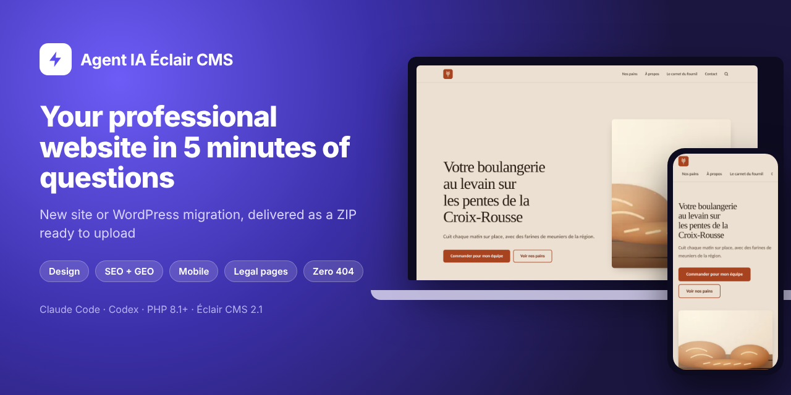
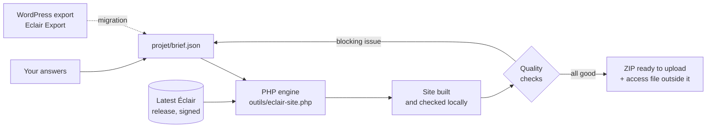

<p align="center">
  <a href="README.md">Français</a> · <b>English</b> · <a href="README.es.md">Español</a> · <a href="README.it.md">Italiano</a> · <a href="README.de.md">Deutsch</a> · <a href="README.pt.md">Português</a>
</p>

<p align="center">
  
</p>

<p align="center">
  <a href="MISES-A-JOUR.md"></a>
  <a href="https://github.com/Jacckisback/eclair-cms"></a>
  
  
  
</p>

# Agent IA Éclair CMS

**An agent for Claude Code or Codex that builds your professional website from A to Z, or moves your WordPress site to Éclair CMS without losing a single address.**

You answer about 5 minutes of questions. The agent builds the complete site on your computer with the latest version of [Éclair CMS](https://github.com/Jacckisback/eclair-cms): pages, copy, art direction, images, SEO, GEO (AI answer engines), mobile version, legal pages and admin account. It checks every page, then hands you **a ZIP file ready to upload to your hosting**, with a step-by-step installation guide.

No need to be a developer: the agent asks the questions, does the technical work and explains every click.

> The agent talks in the user's language. Its instructions and the example sites are written in French; the legal templates cover France and Spain in detail, and other countries from official sources.

---

## Contents

- [What you get](#what-you-get)
- [Preview](#preview)
- [Quick start](#quick-start)
- [Path 1: build a new site](#path-1-build-a-new-site)
- [Path 2: migrate a WordPress site](#path-2-migrate-a-wordpress-site)
- [How it works](#how-it-works)
- [Automatic quality checks](#automatic-quality-checks)
- [Security and trust](#security-and-trust)
- [Requirements](#requirements)
- [Engine commands](#engine-commands)
- [Repository layout](#repository-layout)
- [FAQ](#faq)
- [Known limits](#known-limits)
- [Éclair ecosystem](#éclair-ecosystem)

---

## What you get

| | |
|---|---|
| 🧭 **A guided path** | One question at a time, with clickable choices and always an "Advise me" option. |
| 🎨 **Real design** | 3 art directions proposed from your business (12 ship with Éclair, or a custom one), WCAG contrast guaranteed. |
| ✍️ **Copy with nothing made up** | A business sheet collects your real services, hours, prices and proof. No invented figure, review or label. |
| 🖼️ **Images** | Your photos, or AI images with your own key (fal.ai recommended, OpenAI or Black Forest Labs). |
| 🔎 **SEO and GEO** | Key phrase, titles, meta descriptions, "Key takeaways" summaries, FAQ, structured data, `sitemap.xml`, `robots.txt`, `llms.txt`. Target scores: 80/100 and above. |
| 📱 **Mobile first** | Éclair's theme is built for Lighthouse 100; menus and titles are checked for small screens. |
| ⚖️ **Legal pages** | France (LCEN, consumer mediator), Spain (LSSI, LOPDGDD), GDPR, regulated professions, terms of sale for a shop. |
| 🔁 **WordPress migration** | With the [Eclair Export](https://github.com/Jacckisback/eclair-export) plugin: content, images, PDFs, SEO, menus, redirects, **zero 404**. |
| 📦 **A ZIP ready to upload** | The site folder, the installation guide, the quality reports. The password is delivered **next to** the ZIP, never inside it. |

## Preview

Example shipped with the agent: *Le Fournil des Pentes*, a fictional bakery built by the agent ("Argile" art direction).

<table>
  <tr>
    <td width="72%"></td>
    <td width="28%"></td>
  </tr>
  <tr>
    <td align="center"><sub>Home on desktop</sub></td>
    <td align="center"><sub>Home on mobile</sub></td>
  </tr>
</table>

<p align="center"><br><sub>An inner page: list, image, FAQ marked up for Google and AI engines</sub></p>

<p align="center"><br><sub>The delivered site's admin: content, SEO and GEO scores, priorities</sub></p>

<p align="center"><br><sub>The engine: latest Éclair verified, installation, content, quality check, ZIP</sub></p>

## Quick start

**1. Download the agent**

- Easiest: [`Agent-IA-Eclair-CMS-v1.1.0.zip`](https://github.com/Jacckisback/agent-ia-eclair-cms/raw/main/dist/Agent-IA-Eclair-CMS-v1.1.0.zip) (SHA-256 in [`dist/SHA256SUMS.txt`](dist/SHA256SUMS.txt)), unzip it anywhere.
- Or with git:

```bash
git clone https://github.com/Jacckisback/agent-ia-eclair-cms.git
cd agent-ia-eclair-cms
```

**2. Open the folder in Claude Code** ("Open folder", or `claude` inside the folder). With Codex, open it the same way.

**3. Paste this message:**

```text
Hello! Read CLAUDE.md then REGLES.md, and start building my Éclair CMS website. Ask me the questions one at a time, in English.
```

The first question is: **new site** or **WordPress migration**? At the end, everything is in `sortie/`.

## Path 1: build a new site

| Step | What the agent does |
|---|---|
| 1. Your business | One open question: what you do, for whom, where. |
| 2. Business sheet | Your services, area, hours, prices or quotes, what sets you apart, real proof. |
| 3. The proposal | Site type, pages, menu, tone and 3 art directions, approved in one click. |
| 4. Site address | Domain already bought, to buy (it suggests names) or later. Hosting check. |
| 5. Images | Your photos, AI images (it explains how to get the key) or no images. |
| 6. Legal pages | A short form adapted to your country and status. |
| 7. Admin account | Name, e-mail, short bio (author page). Strong password generated. |
| 8. Build | Copy, images, complete site, SEO/GEO scores read and copy improved. |
| 9. Delivery | The ZIP, a 5-step installation guide and the next 3 priorities. |

## Path 2: migrate a WordPress site

The agent guides you step by step with the free **[Eclair Export](https://github.com/Jacckisback/eclair-export)** plugin. The agent never changes your WordPress, which stays online until the switch.

1. **Install Eclair Export** on your WordPress: the agent gives you the file and every click (Plugins › Add New › Upload).
2. **Diagnosis**: the agent reads the report and tells you what moves as is, what gets simplified (Elementor, Divi) and what is rebuilt in Éclair (forms, widgets, shop).
3. **Speed of the old site** recorded before the switch, for the before/after report.
4. **Export**: you drop the files into `projet/migration/`.
5. **Simulation**: a full summary, nothing written, with a fix for each item that does not migrate.
6. **Migration** with Éclair's official importer, then new design, legal pages checked, forms replaced with Éclair's, cart pages unpublished and redirected.
7. **Every old address checked**: pages, categories, tags, authors, `?p=` links, feeds, `/wp-content/uploads/…` files (images, thumbnails, PDFs). All must lead to the right page.
8. **Switch**: a guide for the same host (with rollback) or a new host (DNS, e-mail, HTTPS), then a migration report for your client and Search Console follow-up.

<p align="center"><br><sub>Migration of the bundled example: 12 old addresses out of 12 lead to the right page</sub></p>

<table>
  <tr>
    <td width="68%"></td>
    <td width="32%"></td>
  </tr>
  <tr>
    <td align="center"><sub>The migrated site, with its new art direction</sub></td>
    <td align="center"><sub>A migrated post: Contact Form 7 replaced with Éclair's form</sub></td>
  </tr>
</table>

## How it works



- The agent writes everything it learns into `projet/brief.json`.
- The engine downloads **the latest Éclair release**, checks its **Ed25519 signature** and SHA-256 hash, then installs it with Éclair's official installer on a local PHP server.
- It applies the brief (settings, content, images, menus, design), or imports the WordPress package with Éclair's official importer.
- It checks the result page by page. A blocking issue means no ZIP: the agent fixes the brief and runs it again.

Content of the delivered ZIP:

```text
sortie/
├── my-site-eclair-v2.1.0.zip
│   └── my-site/
│       ├── site/                   ← upload to the public folder of your hosting
│       ├── INSTALLATION.md         ← the guide, adapted to this site
│       ├── RAPPORT-QUALITE.json    ← every page checked
│       └── ANALYSE-SEO-GEO.json    ← scores and improvement hints
└── my-site-ACCES-ADMIN.txt         ← admin address and password (never online)
```

## Automatic quality checks

On every page: status 200, mobile `viewport` tag, a single H1, meta description, JSON-LD structured data, image alt text, title length. On the site: `sitemap.xml`, `robots.txt`, `llms.txt`.

**Delivery is blocked** (no ZIP) if:

- a "[À compléter]" (to be completed) placeholder would stay visible;
- a WordPress shortcode (`[contact-form-7 …]`) would still be displayed;
- an old WordPress address would end on a 404, or be sent to the home page instead of the matching page;
- a legal page to replace cannot be found, the footer is empty or a menu entry is missing;
- a redirect would be hidden by a page that is still online.

## Security and trust

- **Everything happens on your computer.** The agent never uploads to your hosting, buys nothing and installs no software without your consent.
- **Verified Éclair**: maintainer's Ed25519 signature and SHA-256 hash, exactly as Éclair does for its own updates.
- **Verified Éclair skills** with a public key embedded in the agent (`outils/verifier-skills.php`), never with a script shipped by the downloaded repository.
- **API keys** only in `projet/.env`, never in the brief or the site.
- **Password** generated strong and delivered outside the ZIP; custom admin address (never `/admin`).
- **No invented facts**: no price, review, label or years of experience without a source.
- **Migration**: your WordPress is never touched; a full backup is requested before the switch; the old site is kept at least 3 months.

## Requirements

- **Claude Code** (desktop app or terminal) or **Codex**.
- **PHP 8.1 or later** on your computer, with `curl`, `zip`, `mbstring`, `dom`, `zlib` (ideally `gd`, `sodium`). The agent checks and offers to install it if missing.
- **git** (to load the Éclair Design skill and the skills catalogue).
- **Web hosting** with PHP 8.1+ and Apache or LiteSpeed (almost every shared host).
- Optional: a **fal.ai**, OpenAI or Black Forest Labs account for AI images.
- For a migration: admin access to the WordPress (WordPress 6.0+, PHP 7.4+).

## Engine commands

The agent runs them for you. You can also use them directly:

| Command | Purpose |
|---|---|
| `php outils/eclair-site.php version` | Latest published Éclair version (signed announcement) |
| `php outils/eclair-site.php construire projet/brief.json` | Builds a new site and delivers the ZIP |
| `php outils/eclair-site.php simuler projet/brief.json` | Migration: import simulation, nothing delivered |
| `php outils/eclair-site.php migrer projet/brief.json` | Migration: import, settings, old-address check, ZIP |
| `php outils/eclair-site.php verifier sortie/<site>/site` | Quality check of an already built site |
| `php outils/images.php projet/brief.json` | Generates missing images (fal.ai, OpenAI, FLUX) |
| `php outils/verifier-skills.php <folder>` | Verifies downloaded Éclair skills |

Try the bundled examples:

```bash
php outils/eclair-site.php construire exemples/fournil-des-pentes/brief.json
php outils/eclair-site.php migrer exemples/migration-wordpress/brief.json
```

## Repository layout

| File or folder | Purpose |
|---|---|
| `COMMENCER-ICI.md` | Getting started guide (French) |
| `CLAUDE.md`, `AGENTS.md`, `REGLES.md` | Agent instructions for Claude Code and Codex |
| `.claude/skills/`, `.agents/skills/` | Complete method: path, design, images, SEO/GEO, legal pages, migration, delivery |
| `outils/` | Build, migration and check engine (PHP, no dependency) |
| `projet/` | Your brief, progress, images and WordPress exports |
| `exemples/fournil-des-pentes/` | New-site example (fictional bakery) |
| `exemples/migration-wordpress/` | Migration example with a demo Eclair Export package |
| `DEPANNAGE.md` | Troubleshooting |
| `MISES-A-JOUR.md` | Changelog |
| `dist/` | Downloadable ZIP and its hash |

## FAQ

<details>
<summary><b>Do I need to know how to code?</b></summary>

No. The agent asks questions in plain language, does the technical work and explains every step of going live. You only need to open a folder in Claude Code or Codex.
</details>

<details>
<summary><b>How long does it take?</b></summary>

About 5 minutes of questions for a new site, plus 5 to 15 minutes the very first time if PHP must be installed. A WordPress migration also needs the export time (2 to 15 minutes depending on the site).
</details>

<details>
<summary><b>How much does it cost?</b></summary>

The agent and Éclair CMS are free. You pay for your Claude Code or Codex subscription, your hosting, your domain and, if you choose AI images, a few cents per image at the provider.
</details>

<details>
<summary><b>Does the agent put the site online for me?</b></summary>

No, on purpose: it never connects to your hosting. It hands you the ZIP and a click-by-click guide (file manager or FTP) adapted to your site.
</details>

<details>
<summary><b>My WordPress uses Elementor, WooCommerce or two languages. Will it work?</b></summary>

Text, images, SEO, menus and translations (WPML, Polylang) are carried over. Elementor and Divi layouts are simplified and redesigned with an Éclair art direction. WooCommerce moves to Éclair's lightweight shop (one payment link per product, no cart): the agent tells you frankly when that does not fit your business.
</details>

<details>
<summary><b>What if an old address has no equivalent?</b></summary>

The ZIP is not delivered. The agent finds the matching page and adds the redirect. An exception (old test page, cart) is approved one address at a time, with you.
</details>

<details>
<summary><b>Can I edit the site afterwards?</b></summary>

Yes, in Éclair's admin (visual editor, built-in AI assistant, Claude and ChatGPT connector). Before going live, you can also ask the agent for a change: it rebuilds the site.
</details>

## Known limits

- A **new site** ZIP is built in one language; the second language is added afterwards in the admin. A WordPress migration keeps the languages.
- **No cart or customer accounts**: Éclair's shop works with one payment link (Stripe, PayPal, Revolut Business) per product.
- **No built-in booking**: the agent adds a button to your tool (Calendly, Cal.com…).
- **Elementor and Divi** layouts are not reproduced identically.
- **Legal texts** are templates based on official sources; have them reviewed for a regulated activity or online sales.

## Éclair ecosystem

| Project | Purpose |
|---|---|
| [Éclair CMS](https://github.com/Jacckisback/eclair-cms) | The CMS: ultra-light, no database, built-in SEO and GEO |
| [Eclair Export](https://github.com/Jacckisback/eclair-export) | WordPress plugin for migration diagnosis and export |
| [Éclair Design](https://github.com/Jacckisback/eclair-design) | Art direction and finishing skill for Éclair sites |
| [Éclair Skills](https://github.com/Jacckisback/eclair-skills) | Signed catalogue of agent skills (shop, bookings, multilingual…) |

---

<p align="center">
  Made by <b>Thierry Gustin</b> — <a href="https://eclaircms.org">eclaircms.org</a><br>
  <sub>Changelog: <a href="MISES-A-JOUR.md">MISES-A-JOUR.md</a> · Problem? <a href="DEPANNAGE.md">DEPANNAGE.md</a> or open an <a href="https://github.com/Jacckisback/agent-ia-eclair-cms/issues">issue</a></sub><br>
  <sub>No open-source license has been published for this repository yet: contact the author before reusing the code.</sub>
</p>
