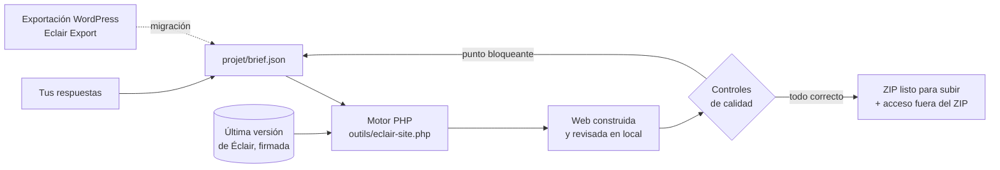

<p align="center">
  <a href="README.md">Français</a> · <a href="README.en.md">English</a> · <b>Español</b> · <a href="README.it.md">Italiano</a> · <a href="README.de.md">Deutsch</a> · <a href="README.pt.md">Português</a>
</p>

<p align="center">
  
</p>

<p align="center">
  <a href="MISES-A-JOUR.md"></a>
  <a href="https://github.com/Jacckisback/eclair-cms"></a>
  
  
  
</p>

# Agent IA Éclair CMS

**Un agente para Claude Code o Codex que crea tu web profesional de la A a la Z, o que pasa tu web de WordPress a Éclair CMS sin perder ni una sola dirección.**

Respondes a unos 5 minutos de preguntas. El agente construye la web completa en tu ordenador con la última versión de [Éclair CMS](https://github.com/Jacckisback/eclair-cms): páginas, textos, dirección de arte, imágenes, SEO, GEO (motores de respuesta de IA), versión móvil, textos legales y cuenta de administración. Revisa cada página y te entrega **un archivo ZIP listo para subir a tu hosting**, con una guía de instalación paso a paso.

No hace falta ser desarrollador: el agente hace las preguntas, se encarga de la parte técnica y te explica cada clic.

> El agente habla en el idioma del usuario. Sus instrucciones y las webs de ejemplo están en francés; los modelos legales cubren en detalle Francia y España, y los demás países a partir de fuentes oficiales.

---

## Índice

- [Lo que obtienes](#lo-que-obtienes)
- [Vista previa](#vista-previa)
- [Inicio rápido](#inicio-rápido)
- [Recorrido 1: crear una web nueva](#recorrido-1-crear-una-web-nueva)
- [Recorrido 2: migrar una web de WordPress](#recorrido-2-migrar-una-web-de-wordpress)
- [Cómo funciona](#cómo-funciona)
- [Controles de calidad automáticos](#controles-de-calidad-automáticos)
- [Seguridad y confianza](#seguridad-y-confianza)
- [Requisitos](#requisitos)
- [Comandos del motor](#comandos-del-motor)
- [Contenido del repositorio](#contenido-del-repositorio)
- [Preguntas frecuentes](#preguntas-frecuentes)
- [Límites conocidos](#límites-conocidos)
- [Ecosistema Éclair](#ecosistema-éclair)

---

## Lo que obtienes

| | |
|---|---|
| 🧭 **Un recorrido guiado** | Una pregunta cada vez, con opciones para hacer clic y siempre la opción «Aconséjame». |
| 🎨 **Un diseño de verdad** | 3 direcciones de arte propuestas según tu actividad (12 incluidas en Éclair, o una a medida), contraste WCAG garantizado. |
| ✍️ **Textos sin inventar nada** | Una ficha de negocio recoge tus servicios, horarios, precios y pruebas reales. Ninguna cifra, opinión o sello inventado. |
| 🖼️ **Imágenes** | Tus fotos, o imágenes generadas por IA con tu propia clave (se recomienda fal.ai; también OpenAI o Black Forest Labs). |
| 🔎 **SEO y GEO** | Palabra clave, títulos, metadescripciones, resúmenes «Lo esencial», FAQ, datos estructurados, `sitemap.xml`, `robots.txt`, `llms.txt`. Objetivo: 80/100 o más. |
| 📱 **Móvil primero** | El tema de Éclair está pensado para Lighthouse 100; menús y títulos revisados para pantallas pequeñas. |
| ⚖️ **Textos legales** | España (aviso legal LSSI, LOPDGDD), Francia (LCEN, mediador), RGPD, profesiones reguladas, condiciones de venta para una tienda. |
| 🔁 **Migración desde WordPress** | Con el plugin [Eclair Export](https://github.com/Jacckisback/eclair-export): contenidos, imágenes, PDF, SEO, menús, redirecciones, **cero 404**. |
| 📦 **Un ZIP listo para subir** | La carpeta de la web, la guía de instalación y los informes de calidad. La contraseña se entrega **al lado** del ZIP, nunca dentro. |

## Vista previa

Ejemplo incluido con el agente: *Le Fournil des Pentes*, una panadería ficticia construida por el agente (dirección de arte «Argile»).

<table>
  <tr>
    <td width="72%"></td>
    <td width="28%"></td>
  </tr>
  <tr>
    <td align="center"><sub>Inicio en ordenador</sub></td>
    <td align="center"><sub>Inicio en móvil</sub></td>
  </tr>
</table>

<p align="center"><br><sub>Una página interior: lista, imagen, FAQ marcada para Google y las IA</sub></p>

<p align="center"><br><sub>La administración de la web entregada: contenidos, puntuaciones SEO y GEO, prioridades</sub></p>

<p align="center"><br><sub>El motor: última versión de Éclair verificada, instalación, contenidos, control de calidad, ZIP</sub></p>

## Inicio rápido

**1. Descarga el agente**

- Lo más sencillo: [`Agent-IA-Eclair-CMS-v1.1.0.zip`](https://github.com/Jacckisback/agent-ia-eclair-cms/raw/main/dist/Agent-IA-Eclair-CMS-v1.1.0.zip) (huella SHA-256 en [`dist/SHA256SUMS.txt`](dist/SHA256SUMS.txt)); descomprímelo donde quieras.
- O con git:

```bash
git clone https://github.com/Jacckisback/agent-ia-eclair-cms.git
cd agent-ia-eclair-cms
```

**2. Abre la carpeta en Claude Code** («Open folder», o `claude` dentro de la carpeta). Con Codex, ábrela igual.

**3. Pega este mensaje:**

```text
¡Hola! Lee CLAUDE.md y luego REGLES.md, y empieza a crear mi web con Éclair CMS. Hazme las preguntas una a una, en español.
```

La primera pregunta es: ¿**web nueva** o **migración desde WordPress**? Al final, todo está en `sortie/`.

## Recorrido 1: crear una web nueva

| Paso | Lo que hace el agente |
|---|---|
| 1. Tu actividad | Una sola pregunta abierta: qué haces, para quién y dónde. |
| 2. Ficha de negocio | Tus servicios, zona, horarios, precios o presupuestos, lo que te diferencia, pruebas reales. |
| 3. La propuesta | Tipo de web, páginas, menú, tono y 3 direcciones de arte, para validar con un clic. |
| 4. La dirección de la web | Dominio ya comprado, por comprar (propone nombres) o más tarde. Revisión del hosting. |
| 5. Las imágenes | Tus fotos, imágenes de IA (te explica cómo conseguir la clave) o sin imágenes. |
| 6. Los textos legales | Una ficha adaptada a tu país y a tu forma jurídica. |
| 7. La cuenta de administración | Nombre, e-mail, breve biografía (página de autor). Contraseña robusta generada. |
| 8. La construcción | Textos, imágenes, web completa, lectura de las puntuaciones SEO/GEO y mejora de los textos. |
| 9. La entrega | El ZIP, la guía de instalación en 5 pasos y las 3 prioridades siguientes. |

## Recorrido 2: migrar una web de WordPress

El agente te guía paso a paso con el plugin gratuito **[Eclair Export](https://github.com/Jacckisback/eclair-export)**. El agente nunca modifica tu WordPress, que sigue en línea hasta el cambio.

1. **Instalar Eclair Export** en tu WordPress: el agente te da el archivo y cada clic (Plugins › Añadir nuevo › Subir plugin).
2. **Diagnóstico**: el agente lee el informe y te dice qué pasa tal cual, qué se simplifica (Elementor, Divi) y qué se rehace en Éclair (formularios, widgets, tienda).
3. **Velocidad de la web antigua** anotada antes del cambio, para el informe antes/después.
4. **Exportación**: dejas los archivos en `projet/migration/`.
5. **Simulación**: balance completo, sin escribir nada, con una solución para cada elemento que no se migra.
6. **Migración** con el importador oficial de Éclair; después, nuevo diseño, textos legales revisados, formularios sustituidos por el de Éclair, páginas de carrito despublicadas y redirigidas.
7. **Control de cada dirección antigua**: páginas, categorías, etiquetas, autores, enlaces `?p=`, feeds, archivos `/wp-content/uploads/…` (imágenes, miniaturas, PDF). Todas deben llevar a la página correcta.
8. **Cambio**: guía para el mismo hosting (con vuelta atrás) o un hosting nuevo (DNS, correo, HTTPS); después, informe de migración para tu cliente y seguimiento en Search Console.

<p align="center"><br><sub>Migración del ejemplo incluido: 12 de 12 direcciones antiguas llevan a la página correcta</sub></p>

<table>
  <tr>
    <td width="68%"></td>
    <td width="32%"></td>
  </tr>
  <tr>
    <td align="center"><sub>La web migrada, con su nueva dirección de arte</sub></td>
    <td align="center"><sub>Un artículo migrado: Contact Form 7 sustituido por el formulario de Éclair</sub></td>
  </tr>
</table>

## Cómo funciona



- El agente anota todo lo que aprende en `projet/brief.json`.
- El motor descarga **la última versión de Éclair**, comprueba su **firma Ed25519** y su huella SHA-256 y la instala con el asistente oficial de Éclair en un servidor PHP local.
- Aplica el brief (ajustes, contenidos, imágenes, menús, diseño) o importa el paquete de WordPress con el importador oficial de Éclair.
- Revisa el resultado página por página. Un punto bloqueante = no hay ZIP: el agente corrige el brief y vuelve a lanzarlo.

Contenido del ZIP entregado:

```text
sortie/
├── mi-web-eclair-v2.1.0.zip
│   └── mi-web/
│       ├── site/                   ← se sube a la carpeta pública del hosting
│       ├── INSTALLATION.md         ← la guía, adaptada a esta web
│       ├── RAPPORT-QUALITE.json    ← control de cada página
│       └── ANALYSE-SEO-GEO.json    ← puntuaciones y mejoras posibles
└── mi-web-ACCES-ADMIN.txt          ← dirección de la administración y contraseña (nunca en línea)
```

## Controles de calidad automáticos

En cada página: respuesta 200, etiqueta móvil `viewport`, un solo título H1, metadescripción, datos estructurados JSON-LD, texto alternativo de las imágenes, longitud de los títulos. En la web: `sitemap.xml`, `robots.txt`, `llms.txt`.

**La entrega se bloquea** (no hay ZIP) si:

- quedaría visible un marcador «[À compléter]» (por completar);
- seguiría mostrándose un shortcode de WordPress (`[contact-form-7 …]`);
- una dirección antigua de WordPress acabaría en 404 o se enviaría a la página de inicio en lugar de a la página equivalente;
- no se encuentra una página legal que había que sustituir, el pie de página está vacío o falta una entrada de menú;
- una redirección quedaría oculta por una página que sigue en línea.

## Seguridad y confianza

- **Todo ocurre en tu ordenador.** El agente no sube nada a tu hosting, no compra nada y no instala ningún programa sin tu permiso.
- **Éclair verificado**: firma Ed25519 del mantenedor y huella SHA-256, igual que hace Éclair con sus propias actualizaciones.
- **Skills de Éclair verificados** con una clave pública integrada en el agente (`outils/verifier-skills.php`), nunca con un script del repositorio descargado.
- **Claves de API** solo en `projet/.env`, nunca en el brief ni en la web.
- **Contraseña** robusta generada y entregada fuera del ZIP; dirección de administración personalizada (nunca `/admin`).
- **Ningún dato inventado**: ni precios, ni opiniones, ni sellos, ni años de experiencia sin fuente.
- **Migración**: tu WordPress no se toca; se pide una copia de seguridad completa antes del cambio; la web antigua se conserva al menos 3 meses.

## Requisitos

- **Claude Code** (app de escritorio o terminal) o **Codex**.
- **PHP 8.1 o superior** en tu ordenador, con `curl`, `zip`, `mbstring`, `dom`, `zlib` (idealmente `gd`, `sodium`). El agente lo comprueba y te propone instalarlo si falta.
- **git** (para cargar el skill Éclair Design y el catálogo de skills).
- Un **hosting** con PHP 8.1+ y Apache o LiteSpeed (casi todos los compartidos).
- Opcional: una cuenta de **fal.ai**, OpenAI o Black Forest Labs para las imágenes de IA.
- Para una migración: acceso de administrador al WordPress (WordPress 6.0+, PHP 7.4+).

## Comandos del motor

El agente los ejecuta por ti. También puedes usarlos directamente:

| Comando | Función |
|---|---|
| `php outils/eclair-site.php version` | Última versión publicada de Éclair (anuncio firmado) |
| `php outils/eclair-site.php construire projet/brief.json` | Construye una web nueva y entrega el ZIP |
| `php outils/eclair-site.php simuler projet/brief.json` | Migración: simulación de la importación, no se entrega nada |
| `php outils/eclair-site.php migrer projet/brief.json` | Migración: importación, ajustes, control de las direcciones antiguas, ZIP |
| `php outils/eclair-site.php verifier sortie/<web>/site` | Control de calidad de una web ya construida |
| `php outils/images.php projet/brief.json` | Genera las imágenes que faltan (fal.ai, OpenAI, FLUX) |
| `php outils/verifier-skills.php <carpeta>` | Verifica los skills de Éclair descargados |

Prueba los ejemplos incluidos:

```bash
php outils/eclair-site.php construire exemples/fournil-des-pentes/brief.json
php outils/eclair-site.php migrer exemples/migration-wordpress/brief.json
```

## Contenido del repositorio

| Archivo o carpeta | Función |
|---|---|
| `COMMENCER-ICI.md` | Guía de inicio (en francés) |
| `CLAUDE.md`, `AGENTS.md`, `REGLES.md` | Instrucciones del agente para Claude Code y Codex |
| `.claude/skills/`, `.agents/skills/` | Método completo: recorrido, diseño, imágenes, SEO/GEO, textos legales, migración, entrega |
| `outils/` | Motor de construcción, migración y control (PHP, sin dependencias) |
| `projet/` | Tu brief, tu progreso, tus imágenes y tus exportaciones de WordPress |
| `exemples/fournil-des-pentes/` | Ejemplo de web nueva (panadería ficticia) |
| `exemples/migration-wordpress/` | Ejemplo de migración con un paquete Eclair Export de demostración |
| `DEPANNAGE.md` | Solución de problemas |
| `MISES-A-JOUR.md` | Novedades de cada versión |
| `dist/` | ZIP descargable y su huella |

## Preguntas frecuentes

<details>
<summary><b>¿Hay que saber programar?</b></summary>

No. El agente hace las preguntas con palabras sencillas, se encarga de la parte técnica y te explica cada paso de la puesta en línea. Solo necesitas abrir una carpeta en Claude Code o Codex.
</details>

<details>
<summary><b>¿Cuánto tiempo hace falta?</b></summary>

Unos 5 minutos de preguntas para una web nueva, más 5 a 15 minutos la primera vez si hay que instalar PHP. Una migración desde WordPress necesita además el tiempo de la exportación (de 2 a 15 minutos según la web).
</details>

<details>
<summary><b>¿Cuánto cuesta?</b></summary>

El agente y Éclair CMS son gratuitos. Pagas tu suscripción a Claude Code o Codex, tu hosting, tu dominio y, si eliges imágenes de IA, unos céntimos por imagen al proveedor.
</details>

<details>
<summary><b>¿El agente publica la web por mí?</b></summary>

No, a propósito: nunca se conecta a tu hosting. Te entrega el ZIP y una guía clic a clic (gestor de archivos o FTP) adaptada a tu web.
</details>

<details>
<summary><b>Mi WordPress usa Elementor, WooCommerce o dos idiomas. ¿Funciona?</b></summary>

Se conservan los textos, imágenes, SEO, menús y traducciones (WPML, Polylang). Los diseños de Elementor y Divi se simplifican y se rediseñan con una dirección de arte de Éclair. WooCommerce pasa a la tienda ligera de Éclair (un enlace de pago por producto, sin carrito): el agente te dice con franqueza cuándo no encaja con tu negocio.
</details>

<details>
<summary><b>¿Y si una dirección antigua no tiene equivalente?</b></summary>

El ZIP no se entrega. El agente busca la página equivalente y añade la redirección. Una excepción (página de prueba antigua, carrito) se valida dirección por dirección, contigo.
</details>

<details>
<summary><b>¿Puedo modificar la web después?</b></summary>

Sí, en la administración de Éclair (editor visual, asistente de IA integrado, conector para Claude y ChatGPT). Antes de publicarla, también puedes pedir un cambio al agente: reconstruye la web.
</details>

## Límites conocidos

- El ZIP de una **web nueva** se construye en un solo idioma; el segundo se crea después en la administración. Una migración desde WordPress conserva los idiomas.
- **Sin carrito ni cuentas de cliente**: la tienda de Éclair funciona con un enlace de pago (Stripe, PayPal, Revolut Business) por producto.
- **Sin reservas integradas**: el agente añade un botón hacia tu herramienta (Calendly, Cal.com…).
- Los diseños de **Elementor y Divi** no se reproducen de forma idéntica.
- Los **textos legales** son modelos basados en fuentes oficiales; haz que los revise un profesional si tu actividad está regulada o vendes en línea.

## Ecosistema Éclair

| Proyecto | Función |
|---|---|
| [Éclair CMS](https://github.com/Jacckisback/eclair-cms) | El CMS: ultraligero, sin base de datos, SEO y GEO integrados |
| [Eclair Export](https://github.com/Jacckisback/eclair-export) | Plugin de WordPress para el diagnóstico y la exportación de la migración |
| [Éclair Design](https://github.com/Jacckisback/eclair-design) | Skill de dirección de arte y acabado de las webs Éclair |
| [Éclair Skills](https://github.com/Jacckisback/eclair-skills) | Catálogo firmado de skills para agentes (tienda, reservas, multilingüe…) |

---

<p align="center">
  Creado por <b>Thierry Gustin</b> — <a href="https://eclaircms.org">eclaircms.org</a><br>
  <sub>Novedades: <a href="MISES-A-JOUR.md">MISES-A-JOUR.md</a> · ¿Un problema? <a href="DEPANNAGE.md">DEPANNAGE.md</a> o abre un <a href="https://github.com/Jacckisback/agent-ia-eclair-cms/issues">issue</a></sub><br>
  <sub>Este repositorio aún no publica ninguna licencia de código abierto: contacta con el autor antes de reutilizar el código.</sub>
</p>
