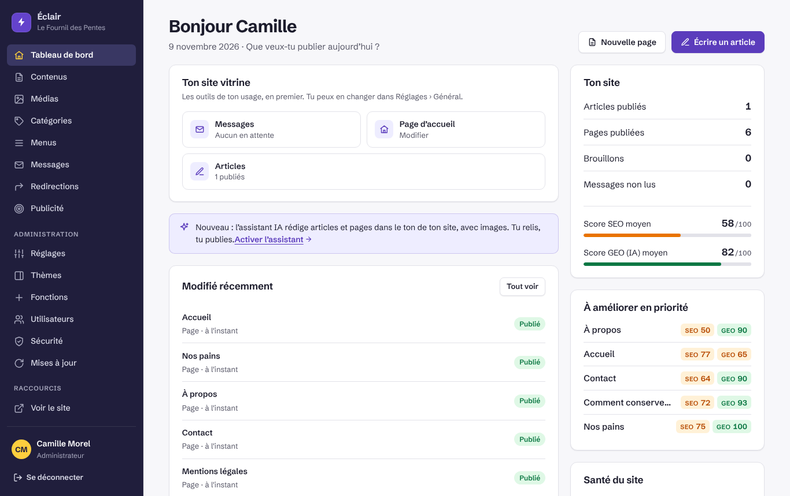
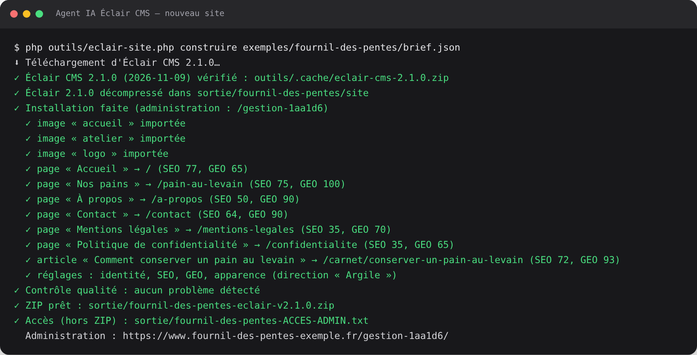
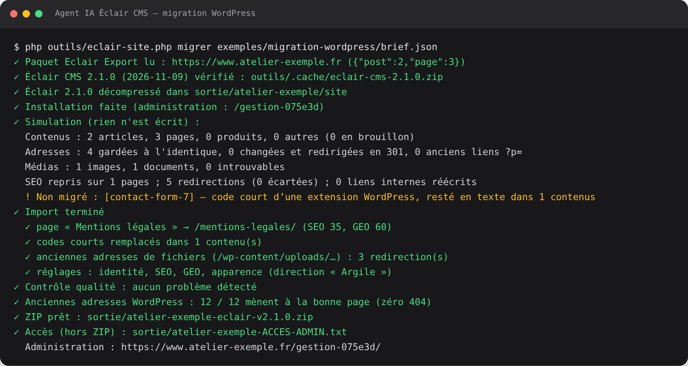
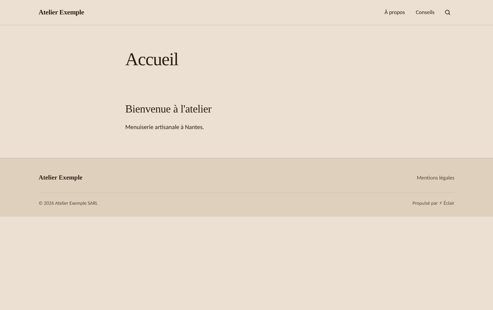
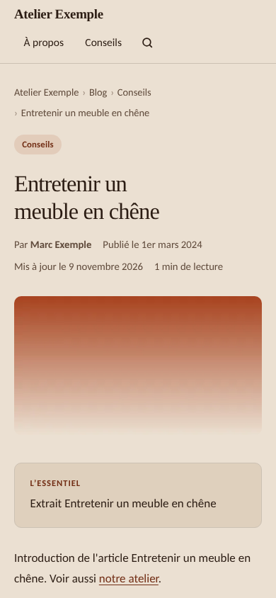
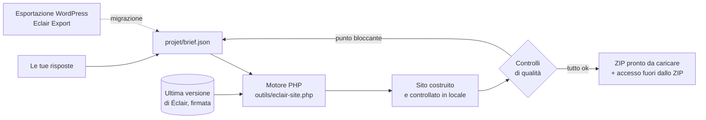

<p align="center">
  <a href="README.md">Français</a> · <a href="README.en.md">English</a> · <a href="README.es.md">Español</a> · <b>Italiano</b> · <a href="README.de.md">Deutsch</a> · <a href="README.pt.md">Português</a>
</p>

<p align="center">
  
</p>

<p align="center">
  <a href="MISES-A-JOUR.md"></a>
  <a href="https://github.com/Jacckisback/eclair-cms"></a>
  
  
  
</p>

# Agent IA Éclair CMS

**Un agente per Claude Code o Codex che crea il tuo sito professionale dalla A alla Z, oppure sposta il tuo sito WordPress su Éclair CMS senza perdere un solo indirizzo.**

Rispondi a circa 5 minuti di domande. L'agente costruisce il sito completo sul tuo computer con l'ultima versione di [Éclair CMS](https://github.com/Jacckisback/eclair-cms): pagine, testi, direzione artistica, immagini, SEO, GEO (motori di risposta IA), versione mobile, note legali e account di amministrazione. Controlla ogni pagina e ti consegna **un file ZIP pronto da caricare sul tuo hosting**, con una guida all'installazione passo dopo passo.

Non serve essere sviluppatori: l'agente fa le domande, si occupa della parte tecnica e ti spiega ogni clic.

> L'agente parla nella lingua dell'utente. Le sue istruzioni e i siti di esempio sono in francese; i modelli legali coprono in dettaglio Francia e Spagna, e gli altri paesi a partire da fonti ufficiali.

---

## Indice

- [Cosa ottieni](#cosa-ottieni)
- [Anteprima](#anteprima)
- [Avvio rapido](#avvio-rapido)
- [Percorso 1: creare un nuovo sito](#percorso-1-creare-un-nuovo-sito)
- [Percorso 2: migrare un sito WordPress](#percorso-2-migrare-un-sito-wordpress)
- [Come funziona](#come-funziona)
- [Controlli di qualità automatici](#controlli-di-qualità-automatici)
- [Sicurezza e fiducia](#sicurezza-e-fiducia)
- [Requisiti](#requisiti)
- [Comandi del motore](#comandi-del-motore)
- [Contenuto del repository](#contenuto-del-repository)
- [Domande frequenti](#domande-frequenti)
- [Limiti noti](#limiti-noti)
- [Ecosistema Éclair](#ecosistema-éclair)

---

## Cosa ottieni

| | |
|---|---|
| 🧭 **Un percorso guidato** | Una domanda alla volta, con scelte cliccabili e sempre l'opzione «Consigliami». |
| 🎨 **Un vero design** | 3 direzioni artistiche proposte in base alla tua attività (12 incluse in Éclair, o una su misura), contrasto WCAG garantito. |
| ✍️ **Testi senza invenzioni** | Una scheda attività raccoglie i tuoi veri servizi, orari, prezzi e prove. Nessuna cifra, recensione o marchio inventato. |
| 🖼️ **Immagini** | Le tue foto, oppure immagini generate dall'IA con la tua chiave (consigliato fal.ai; anche OpenAI o Black Forest Labs). |
| 🔎 **SEO e GEO** | Parola chiave, titoli, meta description, riassunti «L'essenziale», FAQ, dati strutturati, `sitemap.xml`, `robots.txt`, `llms.txt`. Obiettivo: 80/100 e oltre. |
| 📱 **Prima il mobile** | Il tema di Éclair è progettato per Lighthouse 100; menu e titoli controllati per gli schermi piccoli. |
| ⚖️ **Note legali** | Francia (LCEN, mediatore), Spagna (LSSI, LOPDGDD), GDPR, professioni regolamentate, condizioni di vendita per un negozio; altri paesi da fonti ufficiali. |
| 🔁 **Migrazione da WordPress** | Con il plugin [Eclair Export](https://github.com/Jacckisback/eclair-export): contenuti, immagini, PDF, SEO, menu, reindirizzamenti, **zero 404**. |
| 📦 **Uno ZIP pronto da caricare** | La cartella del sito, la guida all'installazione, i rapporti di qualità. La password viene consegnata **accanto** allo ZIP, mai dentro. |

## Anteprima

Esempio fornito con l'agente: *Le Fournil des Pentes*, un panificio immaginario costruito dall'agente (direzione artistica «Argile»).

<table>
  <tr>
    <td width="72%"></td>
    <td width="28%"></td>
  </tr>
  <tr>
    <td align="center"><sub>Home su computer</sub></td>
    <td align="center"><sub>Home su mobile</sub></td>
  </tr>
</table>

<p align="center"><br><sub>Una pagina interna: elenco, immagine, FAQ marcata per Google e per le IA</sub></p>

<p align="center"><br><sub>L'amministrazione del sito consegnato: contenuti, punteggi SEO e GEO, priorità</sub></p>

<p align="center"><br><sub>Il motore: ultima versione di Éclair verificata, installazione, contenuti, controllo di qualità, ZIP</sub></p>

## Avvio rapido

**1. Scarica l'agente**

- Il modo più semplice: [`Agent-IA-Eclair-CMS-v1.1.0.zip`](https://github.com/Jacckisback/agent-ia-eclair-cms/raw/main/dist/Agent-IA-Eclair-CMS-v1.1.0.zip) (impronta SHA-256 in [`dist/SHA256SUMS.txt`](dist/SHA256SUMS.txt)), da decomprimere dove vuoi.
- Oppure con git:

```bash
git clone https://github.com/Jacckisback/agent-ia-eclair-cms.git
cd agent-ia-eclair-cms
```

**2. Apri la cartella in Claude Code** («Open folder», o `claude` nella cartella). Con Codex, aprila allo stesso modo.

**3. Incolla questo messaggio:**

```text
Ciao! Leggi CLAUDE.md e poi REGLES.md, e avvia la creazione del mio sito con Éclair CMS. Fammi le domande una alla volta, in italiano.
```

La prima domanda è: **nuovo sito** o **migrazione da WordPress**? Alla fine, tutto si trova in `sortie/`.

## Percorso 1: creare un nuovo sito

| Passo | Cosa fa l'agente |
|---|---|
| 1. La tua attività | Una sola domanda aperta: cosa fai, per chi, dove. |
| 2. Scheda attività | I tuoi servizi, la zona, gli orari, i prezzi o preventivi, ciò che ti distingue, le prove reali. |
| 3. La proposta | Tipo di sito, pagine, menu, tono e 3 direzioni artistiche, da confermare con un clic. |
| 4. L'indirizzo del sito | Dominio già acquistato, da acquistare (propone dei nomi) o più tardi. Verifica dell'hosting. |
| 5. Le immagini | Le tue foto, immagini IA (ti spiega come ottenere la chiave) o nessuna immagine. |
| 6. Le note legali | Una scheda adattata al tuo paese e alla tua forma giuridica. |
| 7. L'account di amministrazione | Nome, e-mail, breve biografia (pagina autore). Password robusta generata. |
| 8. La costruzione | Testi, immagini, sito completo, lettura dei punteggi SEO/GEO e miglioramento dei testi. |
| 9. La consegna | Lo ZIP, la guida all'installazione in 5 passi e le 3 priorità successive. |

## Percorso 2: migrare un sito WordPress

L'agente ti guida passo dopo passo con il plugin gratuito **[Eclair Export](https://github.com/Jacckisback/eclair-export)**. L'agente non modifica mai il tuo WordPress, che resta online fino al passaggio.

1. **Installare Eclair Export** sul tuo WordPress: l'agente ti dà il file e ogni clic (Plugin › Aggiungi nuovo › Carica plugin).
2. **Diagnosi**: l'agente legge il rapporto e ti dice cosa passa così com'è, cosa viene semplificato (Elementor, Divi) e cosa viene rifatto in Éclair (moduli, widget, negozio).
3. **Velocità del vecchio sito** annotata prima del passaggio, per il rapporto prima/dopo.
4. **Esportazione**: metti i file in `projet/migration/`.
5. **Simulazione**: bilancio completo, senza scrivere nulla, con una soluzione per ogni elemento che non viene migrato.
6. **Migrazione** con l'importatore ufficiale di Éclair, poi nuovo design, note legali verificate, moduli sostituiti da quello di Éclair, pagine del carrello depubblicate e reindirizzate.
7. **Controllo di ogni vecchio indirizzo**: pagine, categorie, tag, autori, link `?p=`, feed, file `/wp-content/uploads/…` (immagini, miniature, PDF). Tutti devono portare alla pagina giusta.
8. **Passaggio**: guida per lo stesso hosting (con ritorno indietro) o un nuovo hosting (DNS, e-mail, HTTPS), poi rapporto di migrazione per il tuo cliente e monitoraggio in Search Console.

<p align="center"><br><sub>Migrazione dell'esempio incluso: 12 vecchi indirizzi su 12 portano alla pagina giusta</sub></p>

<table>
  <tr>
    <td width="68%"></td>
    <td width="32%"></td>
  </tr>
  <tr>
    <td align="center"><sub>Il sito migrato, con la sua nuova direzione artistica</sub></td>
    <td align="center"><sub>Un articolo migrato: Contact Form 7 sostituito dal modulo di Éclair</sub></td>
  </tr>
</table>

## Come funziona



- L'agente annota tutto ciò che impara in `projet/brief.json`.
- Il motore scarica **l'ultima versione di Éclair**, ne verifica la **firma Ed25519** e l'impronta SHA-256, poi la installa con la procedura ufficiale di Éclair su un server PHP locale.
- Applica il brief (impostazioni, contenuti, immagini, menu, design) oppure importa il pacchetto WordPress con l'importatore ufficiale di Éclair.
- Controlla il risultato pagina per pagina. Un punto bloccante = nessuno ZIP: l'agente corregge il brief e rilancia.

Contenuto dello ZIP consegnato:

```text
sortie/
├── mio-sito-eclair-v2.1.0.zip
│   └── mio-sito/
│       ├── site/                   ← da caricare nella cartella pubblica dell'hosting
│       ├── INSTALLATION.md         ← la guida, adattata a questo sito
│       ├── RAPPORT-QUALITE.json    ← controllo di ogni pagina
│       └── ANALYSE-SEO-GEO.json    ← punteggi e possibili miglioramenti
└── mio-sito-ACCES-ADMIN.txt        ← indirizzo dell'amministrazione e password (mai online)
```

## Controlli di qualità automatici

Su ogni pagina: risposta 200, tag mobile `viewport`, un solo titolo H1, meta description, dati strutturati JSON-LD, testo alternativo delle immagini, lunghezza dei titoli. Sul sito: `sitemap.xml`, `robots.txt`, `llms.txt`.

**La consegna viene bloccata** (nessuno ZIP) se:

- resterebbe visibile un segnaposto «[À compléter]» (da completare);
- uno shortcode di WordPress (`[contact-form-7 …]`) resterebbe visualizzato;
- un vecchio indirizzo WordPress finirebbe in 404 o verrebbe mandato alla home invece che alla pagina equivalente;
- una pagina legale da sostituire non si trova, il piè di pagina è vuoto o manca una voce di menu;
- un reindirizzamento sarebbe nascosto da una pagina ancora online.

## Sicurezza e fiducia

- **Tutto avviene sul tuo computer.** L'agente non carica nulla sul tuo hosting, non acquista nulla e non installa alcun programma senza il tuo consenso.
- **Éclair verificato**: firma Ed25519 del manutentore e impronta SHA-256, come fa Éclair per i propri aggiornamenti.
- **Skill di Éclair verificati** con una chiave pubblica integrata nell'agente (`outils/verifier-skills.php`), mai con uno script del repository scaricato.
- **Chiavi API** solo in `projet/.env`, mai nel brief né nel sito.
- **Password** robusta generata e consegnata fuori dallo ZIP; indirizzo di amministrazione personalizzato (mai `/admin`).
- **Nessun dato inventato**: niente prezzi, recensioni, marchi o anni di esperienza senza fonte.
- **Migrazione**: il tuo WordPress non viene toccato; backup completo richiesto prima del passaggio; vecchio sito conservato almeno 3 mesi.

## Requisiti

- **Claude Code** (app desktop o terminale) o **Codex**.
- **PHP 8.1 o superiore** sul tuo computer, con `curl`, `zip`, `mbstring`, `dom`, `zlib` (idealmente `gd`, `sodium`). L'agente lo verifica e propone di installarlo se manca.
- **git** (per caricare lo skill Éclair Design e il catalogo degli skill).
- Un **hosting** con PHP 8.1+ e Apache o LiteSpeed (quasi tutti gli hosting condivisi).
- Facoltativo: un account **fal.ai**, OpenAI o Black Forest Labs per le immagini IA.
- Per una migrazione: accesso da amministratore al WordPress (WordPress 6.0+, PHP 7.4+).

## Comandi del motore

L'agente li esegue per te. Puoi anche usarli direttamente:

| Comando | Funzione |
|---|---|
| `php outils/eclair-site.php version` | Ultima versione pubblicata di Éclair (annuncio firmato) |
| `php outils/eclair-site.php construire projet/brief.json` | Costruisce un nuovo sito e consegna lo ZIP |
| `php outils/eclair-site.php simuler projet/brief.json` | Migrazione: simulazione dell'importazione, nulla viene consegnato |
| `php outils/eclair-site.php migrer projet/brief.json` | Migrazione: importazione, impostazioni, controllo dei vecchi indirizzi, ZIP |
| `php outils/eclair-site.php verifier sortie/<sito>/site` | Controllo di qualità di un sito già costruito |
| `php outils/images.php projet/brief.json` | Genera le immagini mancanti (fal.ai, OpenAI, FLUX) |
| `php outils/verifier-skills.php <cartella>` | Verifica gli skill di Éclair scaricati |

Prova gli esempi inclusi:

```bash
php outils/eclair-site.php construire exemples/fournil-des-pentes/brief.json
php outils/eclair-site.php migrer exemples/migration-wordpress/brief.json
```

## Contenuto del repository

| File o cartella | Funzione |
|---|---|
| `COMMENCER-ICI.md` | Guida introduttiva (in francese) |
| `CLAUDE.md`, `AGENTS.md`, `REGLES.md` | Istruzioni dell'agente per Claude Code e Codex |
| `.claude/skills/`, `.agents/skills/` | Metodo completo: percorso, design, immagini, SEO/GEO, note legali, migrazione, consegna |
| `outils/` | Motore di costruzione, migrazione e controllo (PHP, senza dipendenze) |
| `projet/` | Il tuo brief, i progressi, le immagini e le esportazioni WordPress |
| `exemples/fournil-des-pentes/` | Esempio di nuovo sito (panificio immaginario) |
| `exemples/migration-wordpress/` | Esempio di migrazione con un pacchetto Eclair Export dimostrativo |
| `DEPANNAGE.md` | Risoluzione dei problemi |
| `MISES-A-JOUR.md` | Novità di ogni versione |
| `dist/` | ZIP scaricabile e relativa impronta |

## Domande frequenti

<details>
<summary><b>Bisogna saper programmare?</b></summary>

No. L'agente fa le domande con parole semplici, si occupa della parte tecnica e ti spiega ogni passo della pubblicazione. Devi solo aprire una cartella in Claude Code o Codex.
</details>

<details>
<summary><b>Quanto tempo serve?</b></summary>

Circa 5 minuti di domande per un nuovo sito, più 5-15 minuti la prima volta se bisogna installare PHP. Una migrazione da WordPress richiede in più il tempo dell'esportazione (da 2 a 15 minuti a seconda del sito).
</details>

<details>
<summary><b>Quanto costa?</b></summary>

L'agente ed Éclair CMS sono gratuiti. Paghi l'abbonamento a Claude Code o Codex, l'hosting, il dominio e, se scegli le immagini IA, pochi centesimi per immagine al fornitore.
</details>

<details>
<summary><b>L'agente pubblica il sito al posto mio?</b></summary>

No, di proposito: non si collega mai al tuo hosting. Ti consegna lo ZIP e una guida clic per clic (file manager o FTP) adattata al tuo sito.
</details>

<details>
<summary><b>Il mio WordPress usa Elementor, WooCommerce o due lingue. Funziona?</b></summary>

Testi, immagini, SEO, menu e traduzioni (WPML, Polylang) vengono ripresi. I layout di Elementor e Divi vengono semplificati e ridisegnati con una direzione artistica di Éclair. WooCommerce passa al negozio leggero di Éclair (un link di pagamento per prodotto, senza carrello): l'agente ti dice con franchezza quando non è adatto alla tua attività.
</details>

<details>
<summary><b>E se un vecchio indirizzo non ha un equivalente?</b></summary>

Lo ZIP non viene consegnato. L'agente cerca la pagina equivalente e aggiunge il reindirizzamento. Un'eccezione (vecchia pagina di prova, carrello) si convalida un indirizzo alla volta, insieme a te.
</details>

<details>
<summary><b>Posso modificare il sito dopo?</b></summary>

Sì, nell'amministrazione di Éclair (editor visivo, assistente IA integrato, connettore per Claude e ChatGPT). Prima della pubblicazione puoi anche chiedere una modifica all'agente: ricostruisce il sito.
</details>

## Limiti noti

- Lo ZIP di un **nuovo sito** viene costruito in una sola lingua; la seconda si crea poi nell'amministrazione. Una migrazione da WordPress mantiene le lingue.
- **Niente carrello né account clienti**: il negozio di Éclair funziona con un link di pagamento (Stripe, PayPal, Revolut Business) per prodotto.
- **Nessuna prenotazione integrata**: l'agente aggiunge un pulsante verso il tuo strumento (Calendly, Cal.com…).
- I layout di **Elementor e Divi** non vengono riprodotti in modo identico.
- I **testi legali** sono modelli basati su fonti ufficiali; falli verificare da un professionista per un'attività regolamentata o per la vendita online.

## Ecosistema Éclair

| Progetto | Funzione |
|---|---|
| [Éclair CMS](https://github.com/Jacckisback/eclair-cms) | Il CMS: ultraleggero, senza database, SEO e GEO integrati |
| [Eclair Export](https://github.com/Jacckisback/eclair-export) | Plugin WordPress per la diagnosi e l'esportazione della migrazione |
| [Éclair Design](https://github.com/Jacckisback/eclair-design) | Skill di direzione artistica e rifinitura dei siti Éclair |
| [Éclair Skills](https://github.com/Jacckisback/eclair-skills) | Catalogo firmato di skill per agenti (negozio, prenotazioni, multilingua…) |

---

<p align="center">
  Creato da <b>Thierry Gustin</b> — <a href="https://eclaircms.org">eclaircms.org</a><br>
  <sub>Novità: <a href="MISES-A-JOUR.md">MISES-A-JOUR.md</a> · Un problema? <a href="DEPANNAGE.md">DEPANNAGE.md</a> o apri una <a href="https://github.com/Jacckisback/agent-ia-eclair-cms/issues">issue</a></sub><br>
  <sub>Per questo repository non è ancora pubblicata alcuna licenza open source: contatta l'autore prima di riutilizzare il codice.</sub>
</p>
