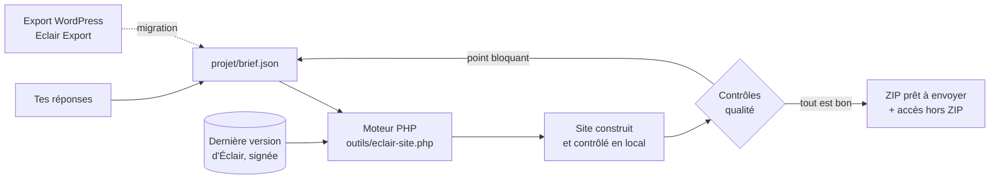

<p align="center">
  <b>Français</b> · <a href="README.en.md">English</a> · <a href="README.es.md">Español</a> · <a href="README.it.md">Italiano</a> · <a href="README.de.md">Deutsch</a> · <a href="README.pt.md">Português</a>
</p>

<p align="center">
  
</p>

<p align="center">
  <a href="MISES-A-JOUR.md"></a>
  <a href="https://github.com/Jacckisback/eclair-cms"></a>
  
  
  
</p>

# Agent IA Éclair CMS

**Un agent pour Claude Code ou Codex qui crée ton site professionnel de A à Z, ou qui passe ton site WordPress sur Éclair CMS sans perdre une seule adresse.**

Tu réponds à environ 5 minutes de questions. L'agent construit le site complet sur ton ordinateur avec la dernière version d'[Éclair CMS](https://github.com/Jacckisback/eclair-cms) : pages, textes, direction artistique, images, SEO, GEO (moteurs de réponse IA), version mobile, mentions légales et compte d'administration. Il contrôle chaque page, puis te livre **un fichier ZIP prêt à envoyer sur ton hébergement**, avec un guide d'installation pas à pas.

Pas besoin d'être développeur : l'agent pose les questions, fait le travail technique et t'explique chaque clic.

---

## Sommaire

- [Ce que tu obtiens](#ce-que-tu-obtiens)
- [Aperçu](#aperçu)
- [Démarrage rapide](#démarrage-rapide)
- [Parcours 1 : créer un nouveau site](#parcours-1--créer-un-nouveau-site)
- [Parcours 2 : migrer un site WordPress](#parcours-2--migrer-un-site-wordpress)
- [Comment ça marche](#comment-ça-marche)
- [Contrôles qualité automatiques](#contrôles-qualité-automatiques)
- [Sécurité et confiance](#sécurité-et-confiance)
- [Prérequis](#prérequis)
- [Commandes du moteur](#commandes-du-moteur)
- [Contenu du dépôt](#contenu-du-dépôt)
- [Questions fréquentes](#questions-fréquentes)
- [Limites connues](#limites-connues)
- [Écosystème Éclair](#écosystème-éclair)

---

## Ce que tu obtiens

| | |
|---|---|
| 🧭 **Un parcours guidé** | Une question à la fois, avec des choix cliquables et toujours l'option « Conseille-moi ». |
| 🎨 **Un vrai design** | 3 directions artistiques proposées d'après ton activité (12 livrées avec Éclair, ou une sur mesure), contrastes WCAG garantis. |
| ✍️ **Des textes sans invention** | Une fiche métier collecte tes vrais services, horaires, prix et preuves. Aucun chiffre, avis ou label inventé. |
| 🖼️ **Des images** | Tes photos, ou des images générées par l'IA avec ta clé (fal.ai recommandé, OpenAI ou Black Forest Labs). |
| 🔎 **SEO et GEO** | Expression-clé, titres, méta-descriptions, résumés « L'essentiel », FAQ, données structurées, `sitemap.xml`, `robots.txt`, `llms.txt`. Scores visés : 80/100 et plus. |
| 📱 **Mobile d'abord** | Thème d'Éclair conçu pour Lighthouse 100, menus et titres vérifiés pour les petits écrans. |
| ⚖️ **Mentions légales** | France (LCEN, médiateur), Espagne (LSSI, LOPDGDD), RGPD, professions réglementées, CGV pour une boutique. |
| 🔁 **Migration WordPress** | Avec l'extension [Eclair Export](https://github.com/Jacckisback/eclair-export) : contenus, images, PDF, SEO, menus, redirections, **zéro 404**. |
| 📦 **Un ZIP prêt à envoyer** | Le dossier du site, le guide d'installation, les rapports de qualité. Le mot de passe est livré **à côté** du ZIP, jamais dedans. |

## Aperçu

Exemple livré avec l'agent : *Le Fournil des Pentes*, une boulangerie fictive construite par l'agent (direction artistique « Argile »).

<table>
  <tr>
    <td width="72%"></td>
    <td width="28%"></td>
  </tr>
  <tr>
    <td align="center"><sub>Accueil sur ordinateur</sub></td>
    <td align="center"><sub>Accueil sur mobile</sub></td>
  </tr>
</table>

<p align="center"><br><sub>Une page intérieure : liste, image, FAQ balisée pour Google et les IA</sub></p>

<p align="center"><br><sub>L'administration du site livré : contenus, scores SEO et GEO, priorités</sub></p>

<p align="center"><br><sub>Le moteur : dernière version d'Éclair vérifiée, installation, contenus, contrôle qualité, ZIP</sub></p>

## Démarrage rapide

**1. Télécharge l'agent**

- Le plus simple : [`Agent-IA-Eclair-CMS-v1.1.0.zip`](https://github.com/Jacckisback/agent-ia-eclair-cms/raw/main/dist/Agent-IA-Eclair-CMS-v1.1.0.zip) (empreinte SHA-256 dans [`dist/SHA256SUMS.txt`](dist/SHA256SUMS.txt)), à décompresser où tu veux.
- Ou avec git :

```bash
git clone https://github.com/Jacckisback/agent-ia-eclair-cms.git
cd agent-ia-eclair-cms
```

**2. Ouvre le dossier dans Claude Code** (« Open folder », ou `claude` dans le dossier). Avec Codex, ouvre-le de la même façon.

**3. Colle ce message** (il est aussi dans `PROMPT-DEMARRAGE.txt`) :

```text
Bonjour ! Lis CLAUDE.md puis REGLES.md, et lance le parcours de création de mon site Éclair CMS. Pose-moi les questions une par une.
```

La première question est : **nouveau site** ou **migration d'un site WordPress** ? À la fin, tout est dans `sortie/`.

## Parcours 1 : créer un nouveau site

| Étape | Ce que fait l'agent |
|---|---|
| 1. Ton activité | Une seule question ouverte : ce que tu fais, pour qui, où. |
| 2. La fiche métier | Tes services, ta zone, tes horaires, tes prix ou devis, ce qui te distingue, tes preuves réelles. |
| 3. La proposition | Type de site, pages, menu, ton et 3 directions artistiques, à valider d'un clic. |
| 4. L'adresse du site | Domaine déjà acheté, à acheter (il propose des noms) ou plus tard. Vérification de l'hébergement. |
| 5. Les images | Tes photos, des images IA (il t'explique comment obtenir la clé) ou pas d'image. |
| 6. Les mentions légales | Une fiche adaptée à ton pays et à ton statut. |
| 7. Le compte d'administration | Nom, e-mail, courte bio (page auteur). Mot de passe solide généré. |
| 8. La construction | Textes, images, site complet, lecture des scores SEO/GEO et amélioration des textes. |
| 9. La livraison | Le ZIP, le guide d'installation en 5 étapes et les 3 priorités pour la suite. |

## Parcours 2 : migrer un site WordPress

L'agent te guide pas à pas avec l'extension gratuite **[Eclair Export](https://github.com/Jacckisback/eclair-export)**. Ton WordPress n'est jamais modifié par l'agent et reste en ligne jusqu'à la bascule.

1. **Installer Eclair Export** sur ton WordPress : l'agent te donne le fichier et chaque clic (Extensions › Ajouter › Téléverser).
2. **Diagnostic** : l'agent lit le rapport et te dit ce qui passe tel quel, ce qui sera simplifié (Elementor, Divi) et ce qui sera refait dans Éclair (formulaires, widgets, boutique).
3. **Vitesse de l'ancien site** notée avant la bascule, pour le rapport avant/après.
4. **Export** : tu glisses les fichiers dans `projet/migration/`.
5. **Simulation** : bilan complet, sans rien écrire, avec une solution pour chaque élément non migré.
6. **Migration** par l'importeur officiel d'Éclair, puis nouveau design, mentions légales vérifiées, formulaires remplacés par celui d'Éclair, pages de panier dépubliées et redirigées.
7. **Contrôle de chaque ancienne adresse** : pages, catégories, étiquettes, auteurs, liens `?p=`, flux, fichiers `/wp-content/uploads/…` (images, miniatures, PDF). Toutes doivent mener à la bonne page.
8. **Bascule** : guide pour le même hébergeur (retour en arrière possible) ou un nouvel hébergeur (DNS, e-mails, HTTPS), puis rapport de migration pour ton client et suivi Search Console.

<p align="center"><br><sub>Migration de l'exemple fourni : 12 anciennes adresses sur 12 mènent à la bonne page</sub></p>

<table>
  <tr>
    <td width="68%"></td>
    <td width="32%"></td>
  </tr>
  <tr>
    <td align="center"><sub>Le site migré, avec sa nouvelle direction artistique</sub></td>
    <td align="center"><sub>Un article migré : Contact Form 7 remplacé par le formulaire d'Éclair</sub></td>
  </tr>
</table>

## Comment ça marche



- L'agent écrit tout ce qu'il apprend dans `projet/brief.json`.
- Le moteur télécharge **la dernière version d'Éclair**, vérifie sa **signature Ed25519** et son empreinte SHA-256, puis l'installe avec l'assistant officiel d'Éclair sur un serveur PHP local.
- Il applique le brief (réglages, contenus, images, menus, design), ou importe le paquet WordPress avec l'importeur officiel d'Éclair.
- Il contrôle le résultat page par page. Un point bloquant = pas de ZIP : l'agent corrige le brief et relance.

Contenu du ZIP livré :

```text
sortie/
├── mon-site-eclair-v2.1.0.zip
│   └── mon-site/
│       ├── site/                   ← à envoyer dans le dossier public de l'hébergement
│       ├── INSTALLATION.md         ← le guide, adapté à ce site
│       ├── RAPPORT-QUALITE.json    ← contrôle de chaque page
│       └── ANALYSE-SEO-GEO.json    ← scores et pistes d'amélioration
└── mon-site-ACCES-ADMIN.txt        ← adresse de l'administration et mot de passe (jamais en ligne)
```

## Contrôles qualité automatiques

Sur chaque page : réponse 200, balise mobile `viewport`, un seul titre H1, méta-description, données structurées JSON-LD, textes alternatifs des images, longueur des titres. Sur le site : `sitemap.xml`, `robots.txt`, `llms.txt`.

**La livraison est bloquée** (aucun ZIP) si :

- un passage « [À compléter] » resterait visible ;
- un code court WordPress (`[contact-form-7 …]`) resterait affiché ;
- une ancienne adresse WordPress finirait en 404 ou serait renvoyée vers l'accueil au lieu de la page équivalente ;
- une page légale à remplacer est introuvable, le pied de page est vide ou une entrée de menu manque ;
- une redirection serait masquée par une page encore en ligne.

## Sécurité et confiance

- **Tout se passe sur ton ordinateur.** L'agent n'envoie rien sur ton hébergement, n'achète rien et n'installe aucun logiciel sans ton accord.
- **Éclair vérifié** : signature Ed25519 du mainteneur et empreinte SHA-256, comme le fait Éclair pour ses propres mises à jour.
- **Skills Éclair vérifiés** avec une clé publique intégrée à l'agent (`outils/verifier-skills.php`), jamais avec un script venu du dépôt téléchargé.
- **Clés d'API** uniquement dans `projet/.env`, jamais dans le brief ni dans le site.
- **Mot de passe** généré solide, livré hors du ZIP ; adresse d'administration personnalisée (jamais `/admin`).
- **Aucun fait inventé** : pas de prix, d'avis, de label ou d'année d'expérience sans source.
- **Migration** : ton WordPress n'est jamais touché ; sauvegarde complète demandée avant la bascule ; ancien site conservé au moins 3 mois.

## Prérequis

- **Claude Code** (application de bureau ou terminal) ou **Codex**.
- **PHP 8.1 ou plus** sur ton ordinateur, avec `curl`, `zip`, `mbstring`, `dom`, `zlib` (et idéalement `gd`, `sodium`). L'agent vérifie et propose de l'installer s'il manque.
- **git** (pour charger les skills Éclair Design et le catalogue de skills).
- Un **hébergement web** avec PHP 8.1+ et Apache ou LiteSpeed (presque tous les mutualisés).
- Facultatif : un compte **fal.ai**, OpenAI ou Black Forest Labs pour les images IA.
- Pour une migration : un accès administrateur au WordPress (WordPress 6.0+, PHP 7.4+).

## Commandes du moteur

L'agent les lance pour toi. Tu peux aussi les utiliser directement :

| Commande | Rôle |
|---|---|
| `php outils/eclair-site.php version` | Dernière version d'Éclair publiée (annonce signée) |
| `php outils/eclair-site.php construire projet/brief.json` | Construit un nouveau site et livre le ZIP |
| `php outils/eclair-site.php simuler projet/brief.json` | Migration : simulation de l'import, rien n'est livré |
| `php outils/eclair-site.php migrer projet/brief.json` | Migration : import, réglages, contrôle des anciennes adresses, ZIP |
| `php outils/eclair-site.php verifier sortie/<site>/site` | Contrôle qualité d'un site déjà construit |
| `php outils/images.php projet/brief.json` | Génère les images manquantes (fal.ai, OpenAI, FLUX) |
| `php outils/verifier-skills.php <dossier>` | Vérifie l'authenticité des skills Éclair téléchargés |

Essaie les exemples fournis :

```bash
php outils/eclair-site.php construire exemples/fournil-des-pentes/brief.json
php outils/eclair-site.php migrer exemples/migration-wordpress/brief.json
```

## Contenu du dépôt

| Fichier ou dossier | Rôle |
|---|---|
| `COMMENCER-ICI.md` | Guide de démarrage |
| `CLAUDE.md`, `AGENTS.md`, `REGLES.md` | Instructions de l'agent pour Claude Code et Codex |
| `.claude/skills/`, `.agents/skills/` | Méthode complète : parcours, design, images, SEO/GEO, mentions légales, migration, livraison |
| `outils/` | Moteur de construction, de migration et de contrôle (PHP, sans dépendance) |
| `projet/` | Ton brief, ta progression, tes images et tes exports WordPress |
| `exemples/fournil-des-pentes/` | Exemple de nouveau site (boulangerie fictive) |
| `exemples/migration-wordpress/` | Exemple de migration avec un paquet Eclair Export de démonstration |
| `DEPANNAGE.md` | Solutions aux problèmes courants |
| `MISES-A-JOUR.md` | Nouveautés de chaque version |
| `dist/` | ZIP prêt à télécharger et son empreinte |

## Questions fréquentes

<details>
<summary><b>Faut-il savoir coder ?</b></summary>

Non. L'agent pose les questions en langage simple, fait le travail technique et t'explique chaque étape de la mise en ligne. Il faut seulement pouvoir ouvrir un dossier dans Claude Code ou Codex.
</details>

<details>
<summary><b>Combien de temps faut-il ?</b></summary>

Environ 5 minutes de questions pour un nouveau site, plus 5 à 15 minutes la toute première fois s'il faut installer PHP. Une migration WordPress demande en plus le temps de l'export (2 à 15 minutes selon la taille du site).
</details>

<details>
<summary><b>Combien ça coûte ?</b></summary>

L'agent et Éclair CMS sont gratuits. Tu paies ton abonnement Claude Code ou Codex, ton hébergement, ton nom de domaine et, si tu choisis des images IA, quelques centimes par image chez le fournisseur.
</details>

<details>
<summary><b>Est-ce que l'agent met le site en ligne à ma place ?</b></summary>

Non, volontairement : il ne se connecte jamais à ton hébergement. Il te livre le ZIP et un guide clic par clic (gestionnaire de fichiers ou FTP), adapté à ton site.
</details>

<details>
<summary><b>Mon WordPress utilise Elementor, WooCommerce ou deux langues. Ça marche ?</b></summary>

Les textes, images, SEO, menus et traductions (WPML, Polylang) sont repris. Les mises en page Elementor et Divi sont simplifiées et redessinées avec une direction artistique d'Éclair. WooCommerce passe dans la boutique légère d'Éclair (un lien de paiement par produit, sans panier) : l'agent te dit franchement quand ce n'est pas adapté à ton activité.
</details>

<details>
<summary><b>Et si une ancienne adresse ne trouve pas d'équivalent ?</b></summary>

Le ZIP n'est pas livré. L'agent cherche la page équivalente et ajoute la redirection. Une exception (vieille page de test, panier) se valide une adresse à la fois, avec toi.
</details>

<details>
<summary><b>Puis-je modifier le site après ?</b></summary>

Oui, dans l'administration d'Éclair (éditeur visuel, assistant IA intégré, connecteur Claude et ChatGPT). Avant la mise en ligne, tu peux aussi demander une modification à l'agent : il reconstruit le site.
</details>

## Limites connues

- Le ZIP d'un **nouveau site** est construit dans une seule langue ; la seconde se crée ensuite dans l'administration. Une migration WordPress, elle, reprend les langues.
- **Pas de panier ni de comptes clients** : la boutique d'Éclair fonctionne avec un lien de paiement (Stripe, PayPal, Revolut Business) par produit.
- **Pas de prise de rendez-vous intégrée** : l'agent ajoute un bouton vers ton outil (Calendly, Cal.com…).
- Les mises en page **Elementor et Divi** ne sont pas reproduites à l'identique.
- Les **textes légaux** sont des modèles établis d'après les textes officiels, à faire relire pour une activité réglementée ou une vente en ligne.

## Écosystème Éclair

| Projet | Rôle |
|---|---|
| [Éclair CMS](https://github.com/Jacckisback/eclair-cms) | Le CMS : ultra léger, sans base de données, SEO et GEO intégrés |
| [Eclair Export](https://github.com/Jacckisback/eclair-export) | Extension WordPress de diagnostic et d'export pour la migration |
| [Éclair Design](https://github.com/Jacckisback/eclair-design) | Skill de direction artistique et de finition des sites Éclair |
| [Éclair Skills](https://github.com/Jacckisback/eclair-skills) | Catalogue signé de skills pour agents (boutique, réservations, multilingue…) |

---

<p align="center">
  Créé par <b>Thierry Gustin</b> — <a href="https://eclaircms.org">eclaircms.org</a><br>
  <sub>Nouveautés : <a href="MISES-A-JOUR.md">MISES-A-JOUR.md</a> · Problème ? <a href="DEPANNAGE.md">DEPANNAGE.md</a> ou une <a href="https://github.com/Jacckisback/agent-ia-eclair-cms/issues">issue</a></sub><br>
  <sub>Aucune licence open source n'est publiée pour ce dépôt à ce jour : pour toute réutilisation du code, contacte l'auteur.</sub>
</p>
