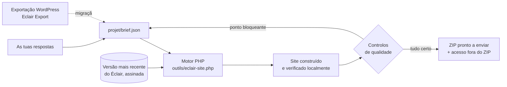

<p align="center">
  <a href="README.md">Français</a> · <a href="README.en.md">English</a> · <a href="README.es.md">Español</a> · <a href="README.it.md">Italiano</a> · <a href="README.de.md">Deutsch</a> · <b>Português</b>
</p>

<p align="center">
  
</p>

<p align="center">
  <a href="MISES-A-JOUR.md"></a>
  <a href="https://github.com/Jacckisback/eclair-cms"></a>
  
  
  
</p>

# Agent IA Éclair CMS

**Um agente para Claude Code ou Codex que cria o teu site profissional de A a Z, ou que passa o teu site WordPress para o Éclair CMS sem perder um único endereço.**

Respondes a cerca de 5 minutos de perguntas. O agente constrói o site completo no teu computador com a versão mais recente do [Éclair CMS](https://github.com/Jacckisback/eclair-cms): páginas, textos, direção de arte, imagens, SEO, GEO (motores de resposta de IA), versão móvel, avisos legais e conta de administração. Verifica cada página e entrega-te **um ficheiro ZIP pronto a enviar para o teu alojamento**, com um guia de instalação passo a passo.

Não é preciso ser programador: o agente faz as perguntas, trata da parte técnica e explica-te cada clique.

> O agente fala na língua do utilizador. As suas instruções e os sites de exemplo estão em francês; os modelos legais cobrem em detalhe a França e a Espanha, e os outros países a partir de fontes oficiais.

---

## Índice

- [O que recebes](#o-que-recebes)
- [Pré-visualização](#pré-visualização)
- [Início rápido](#início-rápido)
- [Percurso 1: criar um site novo](#percurso-1-criar-um-site-novo)
- [Percurso 2: migrar um site WordPress](#percurso-2-migrar-um-site-wordpress)
- [Como funciona](#como-funciona)
- [Controlos de qualidade automáticos](#controlos-de-qualidade-automáticos)
- [Segurança e confiança](#segurança-e-confiança)
- [Requisitos](#requisitos)
- [Comandos do motor](#comandos-do-motor)
- [Conteúdo do repositório](#conteúdo-do-repositório)
- [Perguntas frequentes](#perguntas-frequentes)
- [Limites conhecidos](#limites-conhecidos)
- [Ecossistema Éclair](#ecossistema-éclair)

---

## O que recebes

| | |
|---|---|
| 🧭 **Um percurso guiado** | Uma pergunta de cada vez, com opções para clicar e sempre a opção «Aconselha-me». |
| 🎨 **Um design a sério** | 3 direções de arte propostas a partir da tua atividade (12 incluídas no Éclair, ou uma à medida), contraste WCAG garantido. |
| ✍️ **Textos sem nada inventado** | Uma ficha de negócio recolhe os teus serviços, horários, preços e provas reais. Nenhum número, avaliação ou selo inventado. |
| 🖼️ **Imagens** | As tuas fotos, ou imagens geradas por IA com a tua própria chave (recomenda-se fal.ai; também OpenAI ou Black Forest Labs). |
| 🔎 **SEO e GEO** | Palavra-chave, títulos, meta descrições, resumos «O essencial», FAQ, dados estruturados, `sitemap.xml`, `robots.txt`, `llms.txt`. Objetivo: 80/100 ou mais. |
| 📱 **Primeiro o telemóvel** | O tema do Éclair foi pensado para o Lighthouse 100; menus e títulos verificados para ecrãs pequenos. |
| ⚖️ **Avisos legais** | França (LCEN, mediador), Espanha (LSSI, LOPDGDD), RGPD, profissões regulamentadas, condições de venda para uma loja; outros países a partir de fontes oficiais. |
| 🔁 **Migração do WordPress** | Com o plugin [Eclair Export](https://github.com/Jacckisback/eclair-export): conteúdos, imagens, PDF, SEO, menus, redirecionamentos, **zero 404**. |
| 📦 **Um ZIP pronto a enviar** | A pasta do site, o guia de instalação e os relatórios de qualidade. A palavra-passe é entregue **ao lado** do ZIP, nunca dentro. |

## Pré-visualização

Exemplo incluído com o agente: *Le Fournil des Pentes*, uma padaria fictícia construída pelo agente (direção de arte «Argile»).

<table>
  <tr>
    <td width="72%"></td>
    <td width="28%"></td>
  </tr>
  <tr>
    <td align="center"><sub>Página inicial no computador</sub></td>
    <td align="center"><sub>Página inicial no telemóvel</sub></td>
  </tr>
</table>

<p align="center"><br><sub>Uma página interior: lista, imagem, FAQ marcada para o Google e para as IA</sub></p>

<p align="center"><br><sub>A administração do site entregue: conteúdos, pontuações SEO e GEO, prioridades</sub></p>

<p align="center"><br><sub>O motor: versão mais recente do Éclair verificada, instalação, conteúdos, controlo de qualidade, ZIP</sub></p>

## Início rápido

**1. Descarrega o agente**

- O mais simples: [`Agent-IA-Eclair-CMS-v1.1.0.zip`](https://github.com/Jacckisback/agent-ia-eclair-cms/raw/main/dist/Agent-IA-Eclair-CMS-v1.1.0.zip) (impressão SHA-256 em [`dist/SHA256SUMS.txt`](dist/SHA256SUMS.txt)), para descomprimir onde quiseres.
- Ou com git:

```bash
git clone https://github.com/Jacckisback/agent-ia-eclair-cms.git
cd agent-ia-eclair-cms
```

**2. Abre a pasta no Claude Code** («Open folder», ou `claude` dentro da pasta). Com o Codex, abre-a da mesma forma.

**3. Cola esta mensagem:**

```text
Olá! Lê o CLAUDE.md e depois o REGLES.md, e começa a criar o meu site com o Éclair CMS. Faz-me as perguntas uma a uma, em português.
```

A primeira pergunta é: **site novo** ou **migração do WordPress**? No fim, está tudo em `sortie/`.

## Percurso 1: criar um site novo

| Passo | O que o agente faz |
|---|---|
| 1. A tua atividade | Uma única pergunta aberta: o que fazes, para quem, onde. |
| 2. Ficha de negócio | Os teus serviços, a zona, os horários, os preços ou orçamentos, o que te distingue, provas reais. |
| 3. A proposta | Tipo de site, páginas, menu, tom e 3 direções de arte, para validar com um clique. |
| 4. O endereço do site | Domínio já comprado, por comprar (sugere nomes) ou mais tarde. Verificação do alojamento. |
| 5. As imagens | As tuas fotos, imagens de IA (explica-te como obter a chave) ou sem imagens. |
| 6. Os avisos legais | Uma ficha adaptada ao teu país e ao teu estatuto. |
| 7. A conta de administração | Nome, e-mail, biografia curta (página de autor). Palavra-passe forte gerada. |
| 8. A construção | Textos, imagens, site completo, leitura das pontuações SEO/GEO e melhoria dos textos. |
| 9. A entrega | O ZIP, o guia de instalação em 5 passos e as 3 prioridades seguintes. |

## Percurso 2: migrar um site WordPress

O agente guia-te passo a passo com o plugin gratuito **[Eclair Export](https://github.com/Jacckisback/eclair-export)**. O agente nunca altera o teu WordPress, que continua online até à mudança.

1. **Instalar o Eclair Export** no teu WordPress: o agente dá-te o ficheiro e cada clique (Plugins › Adicionar novo › Carregar plugin).
2. **Diagnóstico**: o agente lê o relatório e diz-te o que passa tal como está, o que é simplificado (Elementor, Divi) e o que é refeito no Éclair (formulários, widgets, loja).
3. **Velocidade do site antigo** registada antes da mudança, para o relatório antes/depois.
4. **Exportação**: colocas os ficheiros em `projet/migration/`.
5. **Simulação**: balanço completo, sem escrever nada, com uma solução para cada elemento que não é migrado.
6. **Migração** com o importador oficial do Éclair; depois, novo design, avisos legais verificados, formulários substituídos pelo do Éclair, páginas do carrinho despublicadas e redirecionadas.
7. **Controlo de cada endereço antigo**: páginas, categorias, etiquetas, autores, ligações `?p=`, feeds, ficheiros `/wp-content/uploads/…` (imagens, miniaturas, PDF). Todos têm de levar à página certa.
8. **Mudança**: guia para o mesmo alojamento (com regresso possível) ou um novo alojamento (DNS, e-mail, HTTPS); depois, relatório de migração para o teu cliente e acompanhamento no Search Console.

<p align="center"><br><sub>Migração do exemplo incluído: 12 de 12 endereços antigos levam à página certa</sub></p>

<table>
  <tr>
    <td width="68%"></td>
    <td width="32%"></td>
  </tr>
  <tr>
    <td align="center"><sub>O site migrado, com a nova direção de arte</sub></td>
    <td align="center"><sub>Um artigo migrado: Contact Form 7 substituído pelo formulário do Éclair</sub></td>
  </tr>
</table>

## Como funciona



- O agente regista tudo o que aprende em `projet/brief.json`.
- O motor descarrega **a versão mais recente do Éclair**, verifica a sua **assinatura Ed25519** e a impressão SHA-256 e instala-a com o assistente oficial do Éclair num servidor PHP local.
- Aplica o brief (definições, conteúdos, imagens, menus, design) ou importa o pacote do WordPress com o importador oficial do Éclair.
- Verifica o resultado página a página. Um ponto bloqueante = sem ZIP: o agente corrige o brief e volta a correr.

Conteúdo do ZIP entregue:

```text
sortie/
├── o-meu-site-eclair-v2.1.0.zip
│   └── o-meu-site/
│       ├── site/                   ← enviar para a pasta pública do alojamento
│       ├── INSTALLATION.md         ← o guia, adaptado a este site
│       ├── RAPPORT-QUALITE.json    ← controlo de cada página
│       └── ANALYSE-SEO-GEO.json    ← pontuações e melhorias possíveis
└── o-meu-site-ACCES-ADMIN.txt      ← endereço da administração e palavra-passe (nunca online)
```

## Controlos de qualidade automáticos

Em cada página: resposta 200, etiqueta móvel `viewport`, um único título H1, meta descrição, dados estruturados JSON-LD, texto alternativo das imagens, tamanho dos títulos. No site: `sitemap.xml`, `robots.txt`, `llms.txt`.

**A entrega é bloqueada** (sem ZIP) se:

- ficaria visível um marcador «[À compléter]» (por completar);
- um shortcode do WordPress (`[contact-form-7 …]`) continuaria a aparecer;
- um endereço antigo do WordPress acabaria num 404 ou seria enviado para a página inicial em vez da página equivalente;
- não se encontra uma página legal a substituir, o rodapé está vazio ou falta uma entrada de menu;
- um redirecionamento ficaria escondido por uma página ainda online.

## Segurança e confiança

- **Tudo acontece no teu computador.** O agente não envia nada para o teu alojamento, não compra nada e não instala nenhum programa sem o teu acordo.
- **Éclair verificado**: assinatura Ed25519 do responsável e impressão SHA-256, tal como o Éclair faz nas suas próprias atualizações.
- **Skills do Éclair verificados** com uma chave pública integrada no agente (`outils/verifier-skills.php`), nunca com um script do repositório descarregado.
- **Chaves de API** apenas em `projet/.env`, nunca no brief nem no site.
- **Palavra-passe** forte gerada e entregue fora do ZIP; endereço de administração personalizado (nunca `/admin`).
- **Nenhum dado inventado**: nem preços, nem avaliações, nem selos, nem anos de experiência sem fonte.
- **Migração**: o teu WordPress não é tocado; é pedida uma cópia de segurança completa antes da mudança; o site antigo é guardado pelo menos 3 meses.

## Requisitos

- **Claude Code** (app de computador ou terminal) ou **Codex**.
- **PHP 8.1 ou superior** no teu computador, com `curl`, `zip`, `mbstring`, `dom`, `zlib` (idealmente `gd`, `sodium`). O agente verifica e propõe instalá-lo se faltar.
- **git** (para carregar o skill Éclair Design e o catálogo de skills).
- Um **alojamento web** com PHP 8.1+ e Apache ou LiteSpeed (quase todos os partilhados).
- Opcional: uma conta **fal.ai**, OpenAI ou Black Forest Labs para as imagens de IA.
- Para uma migração: acesso de administrador ao WordPress (WordPress 6.0+, PHP 7.4+).

## Comandos do motor

O agente executa-os por ti. Também os podes usar diretamente:

| Comando | Função |
|---|---|
| `php outils/eclair-site.php version` | Última versão publicada do Éclair (anúncio assinado) |
| `php outils/eclair-site.php construire projet/brief.json` | Constrói um site novo e entrega o ZIP |
| `php outils/eclair-site.php simuler projet/brief.json` | Migração: simulação da importação, nada é entregue |
| `php outils/eclair-site.php migrer projet/brief.json` | Migração: importação, definições, controlo dos endereços antigos, ZIP |
| `php outils/eclair-site.php verifier sortie/<site>/site` | Controlo de qualidade de um site já construído |
| `php outils/images.php projet/brief.json` | Gera as imagens em falta (fal.ai, OpenAI, FLUX) |
| `php outils/verifier-skills.php <pasta>` | Verifica os skills do Éclair descarregados |

Experimenta os exemplos incluídos:

```bash
php outils/eclair-site.php construire exemples/fournil-des-pentes/brief.json
php outils/eclair-site.php migrer exemples/migration-wordpress/brief.json
```

## Conteúdo do repositório

| Ficheiro ou pasta | Função |
|---|---|
| `COMMENCER-ICI.md` | Guia de início (em francês) |
| `CLAUDE.md`, `AGENTS.md`, `REGLES.md` | Instruções do agente para Claude Code e Codex |
| `.claude/skills/`, `.agents/skills/` | Método completo: percurso, design, imagens, SEO/GEO, avisos legais, migração, entrega |
| `outils/` | Motor de construção, migração e controlo (PHP, sem dependências) |
| `projet/` | O teu brief, o progresso, as imagens e as exportações do WordPress |
| `exemples/fournil-des-pentes/` | Exemplo de site novo (padaria fictícia) |
| `exemples/migration-wordpress/` | Exemplo de migração com um pacote Eclair Export de demonstração |
| `DEPANNAGE.md` | Resolução de problemas |
| `MISES-A-JOUR.md` | Novidades de cada versão |
| `dist/` | ZIP para descarregar e a sua impressão |

## Perguntas frequentes

<details>
<summary><b>É preciso saber programar?</b></summary>

Não. O agente faz as perguntas em linguagem simples, trata da parte técnica e explica-te cada passo da publicação. Só precisas de abrir uma pasta no Claude Code ou no Codex.
</details>

<details>
<summary><b>Quanto tempo demora?</b></summary>

Cerca de 5 minutos de perguntas para um site novo, mais 5 a 15 minutos na primeira vez se for preciso instalar o PHP. Uma migração do WordPress precisa também do tempo da exportação (de 2 a 15 minutos, consoante o site).
</details>

<details>
<summary><b>Quanto custa?</b></summary>

O agente e o Éclair CMS são gratuitos. Pagas a tua subscrição do Claude Code ou do Codex, o alojamento, o domínio e, se escolheres imagens de IA, alguns cêntimos por imagem ao fornecedor.
</details>

<details>
<summary><b>O agente publica o site por mim?</b></summary>

Não, de propósito: nunca se liga ao teu alojamento. Entrega-te o ZIP e um guia clique a clique (gestor de ficheiros ou FTP) adaptado ao teu site.
</details>

<details>
<summary><b>O meu WordPress usa Elementor, WooCommerce ou duas línguas. Funciona?</b></summary>

Os textos, imagens, SEO, menus e traduções (WPML, Polylang) são mantidos. Os layouts do Elementor e do Divi são simplificados e redesenhados com uma direção de arte do Éclair. O WooCommerce passa para a loja leve do Éclair (uma ligação de pagamento por produto, sem carrinho): o agente diz-te com franqueza quando isso não se adequa ao teu negócio.
</details>

<details>
<summary><b>E se um endereço antigo não tiver equivalente?</b></summary>

O ZIP não é entregue. O agente procura a página equivalente e acrescenta o redirecionamento. Uma exceção (página de teste antiga, carrinho) é validada um endereço de cada vez, contigo.
</details>

<details>
<summary><b>Posso alterar o site depois?</b></summary>

Sim, na administração do Éclair (editor visual, assistente de IA integrado, conector para Claude e ChatGPT). Antes de o publicar, também podes pedir uma alteração ao agente: ele reconstrói o site.
</details>

## Limites conhecidos

- O ZIP de um **site novo** é construído numa só língua; a segunda é criada depois na administração. Uma migração do WordPress mantém as línguas.
- **Sem carrinho nem contas de cliente**: a loja do Éclair funciona com uma ligação de pagamento (Stripe, PayPal, Revolut Business) por produto.
- **Sem marcações integradas**: o agente acrescenta um botão para a tua ferramenta (Calendly, Cal.com…).
- Os layouts do **Elementor e do Divi** não são reproduzidos de forma idêntica.
- Os **textos legais** são modelos baseados em fontes oficiais; pede a um profissional que os reveja se a tua atividade for regulamentada ou se venderes online.

## Ecossistema Éclair

| Projeto | Função |
|---|---|
| [Éclair CMS](https://github.com/Jacckisback/eclair-cms) | O CMS: ultraleve, sem base de dados, SEO e GEO integrados |
| [Eclair Export](https://github.com/Jacckisback/eclair-export) | Plugin WordPress de diagnóstico e exportação para a migração |
| [Éclair Design](https://github.com/Jacckisback/eclair-design) | Skill de direção de arte e acabamento dos sites Éclair |
| [Éclair Skills](https://github.com/Jacckisback/eclair-skills) | Catálogo assinado de skills para agentes (loja, marcações, multilíngue…) |

---

<p align="center">
  Criado por <b>Thierry Gustin</b> — <a href="https://eclaircms.org">eclaircms.org</a><br>
  <sub>Novidades: <a href="MISES-A-JOUR.md">MISES-A-JOUR.md</a> · Um problema? <a href="DEPANNAGE.md">DEPANNAGE.md</a> ou abre uma <a href="https://github.com/Jacckisback/agent-ia-eclair-cms/issues">issue</a></sub><br>
  <sub>Este repositório ainda não publica nenhuma licença open source: contacta o autor antes de reutilizar o código.</sub>
</p>
